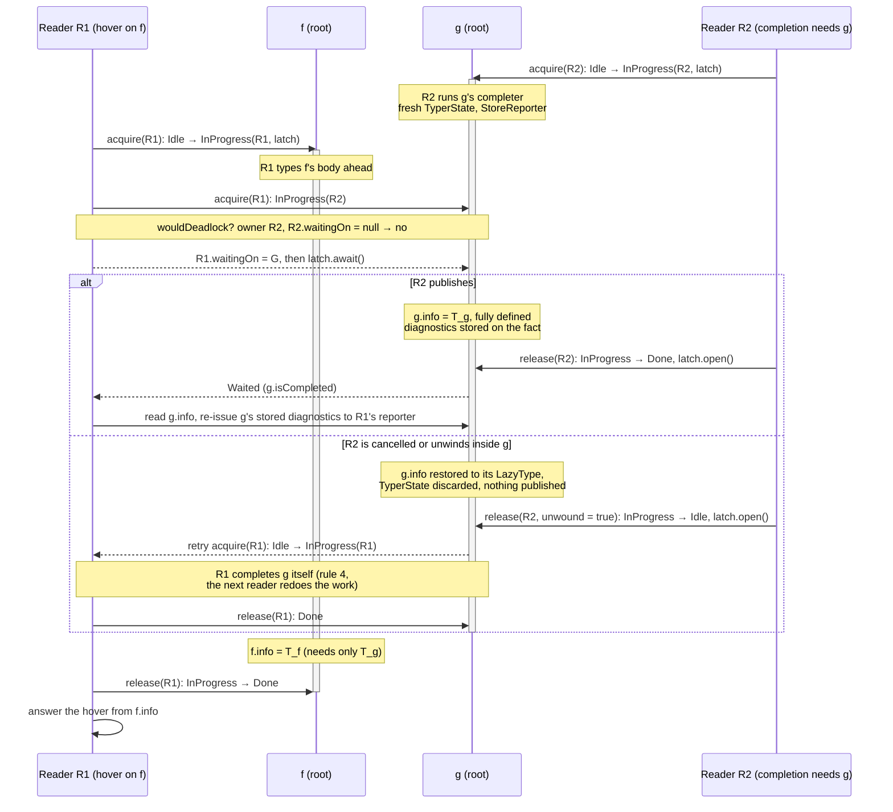

# Several readers over one session: design notes

Status: exploration, 23 October 2026. Builds on the session of [interactive-session.md](interactive-session.md) (targeting, one run per content, cancellation that unwinds) and on Track I's models in `retronym/jvm-lang-models` (`packages/scala/docs/track-i*.md`, `Query/Lazy.lean`, `Query/Interrupt.lean`, `ScalaTypes/ToyTree.lean`, the Java toy in `packages/scala/probes/interrupt`). No code yet.

## Summary for a busy reader

The session answers one request at a time: Metals' `CompilerAccess` queues requests on one thread, and the driver's run, typer state and caches assume a single caller. The question here is what it takes for two requests on the same session (a hover while the session is being completed in the background, two files' requests over one classpath symbol table) to run at the same time, the way Kotlin's K2 Analysis API and IntelliJ's PSI serve concurrent read actions.

The answer this note proposes:

- **A read/write regime, not snapshots.** A write (new content: a fresh run, a re-index) is exclusive; it raises the session's sticky cancellation flag, waits for the readers to unwind, and then mutates. Readers are `runUpTo` requests at the typer phase. Roslyn-style immutable snapshots, where an old reader finishes against the old world while the new one is built, are out of reach while a run brings shared classpath denotations forward to its own run id (I14): the symbol table's clock does not roll back, so two runs cannot be read at once.
- **What a reader may write, by K2's four rules.** A reader writes only what is (1) derived and disposable by the next write, (2) published once and only when consistent, (3) idempotent, so whichever reader wins writes the same value, and (4) left unpublished if the reader is cancelled. dotc's typer state sorts into five kinds against those rules (§3); each kind has one treatment.
- **Completion becomes K2's lazy resolve.** A denotation's completion gets an owner: the thread completing it sees its intermediate state (a `TempClassInfo`, a re-entrant `Touched`), every other thread waits on a barrier until the completer publishes or unwinds, and an unwound completion leaves the symbol completable for the next reader. This is `FirInProcessOfResolvingToPhaseStateWithBarrier` in LL FIR and the black hole two evaluators meet in a parallel Haskell runtime.
- **Concurrency adds three hazards that abort-and-restart did not have** (§4). A *peek* at an in-progress completion (`isCompleting`, thirteen sites) becomes a race whose outcome depends on timing, so a peek must mean "in progress on this thread" and otherwise wait. A *wait-for cycle* between two threads is a dependency cycle and must be reported as `CyclicReference` in the thread that closes it, not deadlock. And *side effects of forcing* land on whichever reader forced: a completer's diagnostics go to that reader's reporter, so a hover that forced a signature swallows the error a diagnostics pass needed; they have to be stored with the fact.
- **Skipped statements are facts too.** A resume into a skipped statement is a lazy computation over a shared value; it gets the same owner/barrier treatment, and the unit's typed tree becomes a persistent value replaced by compare-and-set rather than spliced in place.
- **The batch compiler pays nothing it can measure.** The concurrent implementations (interning, caches that are maps, the completion barrier) are chosen when the `ContextBase` is built in interactive mode; the shared fast paths change only where a field's publication must be ordered, and that is measured with perflab before it is kept.
- **Model first, as Track I did.** Two forcers over one `Query.Lazy` store with owned black holes: an interleaving that respects the barrier agrees with a sequential `forceAll`, a wait-for cycle implies a dependency cycle, and a peek at another thread's black hole is the counterexample. The Java toy gets a concurrent dotc kernel and a deterministic scheduler over its safepoints.

**Status, 24 October 2026.** Step 0 (§0) and step 1 (§7) are done. Steps 2 and 3 are built on [retronym/scala3#84](https://github.com/retronym/scala3/pull/84) (branch `claude/mr-code-813f14`): the `Reader`, the coarse completion lock, the read/write regime, concurrent interners and caches per `ContextBase`, release/acquire publication, findings I34–I51 (§8), the x-ray's background pass as the demo, and a perflab A/B that puts the batch cost under about 2% without resolving below it (§5). The lock-wait milestone (§8) showed that readers outside the lock are fast (hovers 1 ms median beside a background pass) but wrong (I48: intermediate completion state is visible), and that every read under the lock is right but slow (141 ms median, 457 ms p90): step 3's premise, concurrency in body typing only, does not survive dotc's completers. Step 4 is built as a feature-flagged mode, `-Yinteractive-readers` (off: step 3's serialised behaviour; on: the owner and barrier per root, a typer state and a reporter per completion, wait-for cycles backed off): with it the suites pass with readers outside the lock (I48 closed, findings I52–I57) and hovers beside the background pass are about 1 ms median, at about the serialised pass's own time (the 2× first measured was load and a shared server; the flag's own machinery is about 2% of the pass's CPU, §8 step 4). I59 (diagnostics lost by a single reader with the flag) is fixed; I60 (two-reader soak failures under heavy load) is open. The x-ray's replay of a recorded Metals session per mode found I58, a whole-file run that left no session (fixed); with it fixed, the three modes do the same work on an editing session, one whole-file run per edit. Beside it, on their own branches: a range target for inlay hints and semantic tokens (`claude/range-target`), a session that survives a body edit (`claude/body-edit`, design approved, implementing), and the fix for a stock mtags bug the measurement surfaced (`claude/stale-denot-run-451014`, I50: a job-queue reset leaves the old executor's backlog running on a second thread).

Whether to build it at all is §1's question, and step 0 of the plan measures it.

## 0. Measured

23 October 2026, on the branch at `cb68840779` (the session, with targeting) plus one instrumentation commit: `Scala3CompilerAccess` prints a `[dotc-queue]` line per request under `-Yinteractive-log` (the time it waited in `CompilerJobQueue`, the request that was running when it was submitted), and `QueueReplaySuite` (presentation-compiler tests) replays an editor trace against `ScalaPresentationCompiler` with its real job queue. Logs, profiles, summaries and the scripts are under `/Users/jzaugg-virtus/code/scratch/mr-measure/` (`replay/`, `profile/`, `scripts/`); the scripts are also beside the other replay scripts in `jvm-lang-models/packages/scala/probes/interrupt/metals-demo/` (uncommitted there).

### The trace

The request trace is the VS Code session of §7 of [interactive-session.md](interactive-session.md), recorded in `~/code/scratch/dotc-session-dotc/.metals/lsp.trace.json` (Metals 1.6.9, the compiler's own sources as a project, semantic highlighting off in the settings but asked for by VS Code anyway): 46 files opened, 18 edits, and per cursor stop what VS Code sends, a document highlight, a hover, inlay hints for the visible range, semantic tokens after a change, definitions on ⌘-hover, 18 completions, and 42 `$/cancelRequest`s. `trace_to_events.py` turns it into 814 presentation-compiler events with the file's text at each moment and offsets instead of positions; requests that do not reach the presentation compiler (document symbol, code lens, folding, code actions) and sources opened from jars are dropped. The trace has whole-second timestamps, so a replay sends the requests of one second either back to back (`burst`, the upper bound on queueing) or spread evenly over the second (`spread`, the lower bound), and caps the pauses between seconds at one second: the 12 hours of the trace, most of it idle, replay in about four minutes, denser than the real session.

Three replays, each on JDK 21.0.12 with `-Yinteractive-log`:

- `burst` and `spread`: headless, `QueueReplaySuite` in the test JVM, the files typed against the test classpath (class directories).
- `jars`: the same, typed against the Metals project's classpath from its Bloop config (the published compiler and library jars), under async-profiler.
- `metals`: the same events through Metals 1.6.9 over stdio (`replay_trace_lsp.py`, on a copy of the project at `~/code/scratch/dotc-session-replay`), the instrumented presentation compiler installed into `~/.ivy2/local` as `3.10.2-RC1-bin-SNAPSHOT`; Metals adds its own requests to the queue (the references and definition fallbacks over other files, semanticdb for jar sources) and its 20 s timeout cancels what starves.

```bash
sbt -java-home ~/.sdkman/candidates/java/17.0.20-tem --client "; scala3-presentation-compiler/Test/compile ; export scala3-presentation-compiler/Test/fullClasspath"
java -Xss8m -Xmx4g -Dreplay.events=replay-events.json -Dreplay.spread=burst -Dreplay.idleCap=1000 [-Dreplay.classpath=metals-classpath.txt] [-agentpath:/opt/homebrew/lib/libasyncProfiler.dylib=start,event=cpu,interval=1ms,collapsed,file=replay-cpu.collapsed] -cp <test classpath> org.junit.runner.JUnitCore dotty.tools.pc.tests.completion.QueueReplaySuite
python3 -I replay_trace_lsp.py java -cp "$(coursier fetch -p org.scalameta:metals_2.13:1.6.9)" scala.meta.metals.Main -- ~/code/scratch/dotc-session-replay replay-events.json metals-burst.json 1000 burst
python3 -I analyze_queue.py <log>; python3 -I completer_share.py <collapsed>
```

### 1. Queueing delay

Per request, the time between its submission to `CompilerJobQueue` and the start of its job (`wait`), the job's own time (the provider and the driver), and the driver's time from the request log. Hover, definition and completion are targeted (`runUpTo`); inlay hints, semantic tokens and references type the whole file (`run`), and document highlight completes the session (§7 of the session notes).

| replay | requests | waited behind another | hover wait median / p90 / max | hovers waiting > 50 ms / > 200 ms | hover job median | hover driver median |
|---|---|---|---|---|---|---|
| burst (test classpath) | 617 | 426 | 6 / 142 / 9,207 ms | 31 / 10 of 128 | 7.9 ms | 0.1 ms |
| spread | 658 | 113 | 0.1 / 198 / 9,798 ms | 20 / 14 of 142 | 8.5 ms | 0.1 ms |
| jars | 607 | 436 | 7 / 533 / 4,096 ms | 35 / 19 of 126 | 8.1 ms | 0.1 ms |
| metals | 753 | 521 | 7 / 218 / 2,979 ms | 54 / 21 of 174 | 8.0 ms | 0.1 ms |

The hover itself costs nothing in the driver once the session holds the file (served, 0.1 ms) and about 8 ms in the provider around it; what the editor waits for is the queue. The queue is LIFO (the newest request runs first), so a request that arrives during a burst waits for the request that was running and for every newer one: in the Metals replay 54 of the 534 waiting requests saw ten or more newer requests run first, and the 20 s timeout cancelled the ones that starved (49 of 153 hovers answered by cancellation, most of them timeouts, in a replay denser than the real session).

Where the waiting time went, summed over all waiting requests, by what the jobs that ran in between did in the driver (`whole-file` is a `run` that typed the file; `cached-whole-file` is a provider over an already typed file, inlay hints or semantic tokens, which costs no driver time but 100 to 150 ms of provider time per request; `completes-session` is document highlight typing the session's skipped statements; `targeted-*` are `runUpTo` requests):

| ran in between | burst | spread | jars | metals |
|---|---|---|---|---|
| whole-file run | 50% | 50% | 38% | 46% |
| provider over a cached whole-file run | 40% | 33% | 30% | 35% |
| completes the session | 3% | 5% | 15% | 8% |
| targeted, fresh or resumed | 1% | 7% | 7% | 6% |
| targeted, served | 2% | 1% | 3% | 5% |

So 89 to 93 percent of all queueing is behind whole-file work: the run that the first inlay-hint, semantic-token or document-highlight request after an open or an edit costs (median 360 ms on these files, 1.7 s cold on `TypeErasure.scala`, 6.2 s cold on `Types.scala`), and the providers that walk the whole typed tree afterwards. Targeted requests behind targeted requests are 3 to 12 percent of the waiting, and a targeted request's job is 6 to 8 ms, so a hover queued behind a hover waits a frame, not a keystroke.

What a second reader would buy here is the ability to serve a hover beside the whole-file run or the inlay-hint walk of the same file. What cancel-the-older-reader buys is already in: the LIFO order, and the session's cancellation that unwinds a whole-file run at its next checkpoint (none of the cancellations in these replays hit a run mid-way, since Metals cancels on the client's `$/cancelRequest` and the timeout only).

### 2. Completer share

async-profiler, `event=cpu`, 1 ms, over the `jars` replay (the compiler's sources against the published jars, 116,181 samples) and over the `burst` replay (test classpath, 99,006 samples), and over `SessionOracleSuite` (cold JVM, one driver per test, mostly fresh runs and resumes: 28,165 samples). Stacks are split by the driver entry point, `runUpTo0` (a targeted reader) or `run0` (a whole-file run), and classified: `completer` if any frame is inside a completion (`completeFrom`, `lockAndComplete`, a Namer completer, a symbol loader, `TreeUnpickler`, `ClassfileParser`, a lazy annotation, `InheritedCache`), including the typing a completer does and the completions forced from typing; `typing` if `Typer.typed` is on the stack with no completion above or below it; `other` for parsing, indexing, the splice and the providers. Classpath IO (`stat`, `open`, directory listings, zip lookups, from the symbol loaders) is the part of the completer share that is file-system probing.

| profile | root | completers | of which Namer / TASTy / loaders | of which classpath IO | body typing | other |
|---|---|---|---|---|---|---|
| jars replay | `runUpTo0` (3,501 samples) | 79% | 39% / 27% / 12% | 38% | 6% | 15% |
| jars replay | `run0` (23,156) | 64% | 46% / 13% / 5% | 14% | 30% | 6% |
| burst replay (class dirs) | `runUpTo0` (1,421) | 78% | 55% / 5% / 18% | 56% | 5% | 17% |
| burst replay (class dirs) | `run0` (24,657) | 70% | 48% / 13% / 8% | 28% | 25% | 5% |
| oracle suite (cold) | `runUpTo0` (2,392) | 65% | 34% / 12% / 19% | 38% | 20% | 16% |
| oracle suite (cold) | `run0` (2,774) | 69% | 45% / 11% / 12% | 34% | 24% | 8% |

Two things the numbers say. A targeted reader spends 3 to 4 percent of the driver's CPU in a replay (3,501 of 26,657 driver samples in the `jars` run): with targeting, the readers are not where the time is; the whole-file runs are. And of a reader's own time, four fifths is inside completers, a fifth of it (two fifths on class directories) in the file system under the symbol loaders, and body typing is 5 to 20 percent; even a whole-file run is 64 to 70 percent completers. A coarse completion lock (step 3) would serialise four fifths of a reader and two thirds of a background run: two readers over one file would mostly wait for each other's completions, and the gain from concurrency would be bounded by the fifth to the third that is body typing. Flame graphs: `/Users/jzaugg-virtus/code/scratch/mr-measure/profile/replay-jars-cpu.html`, `replay-burst-cpu.html`, `oracle-cpu.html`; the collapsed stacks are beside them, gzipped.

### Verdict

Queueing delay after targeting is real at the tail (a hover's p90 wait is 140 to 530 ms in a replay denser than the editor session, its median 6 ms) but it is not the delay a second reader of §1 would remove: nine tenths of it is behind whole-file work, the first `run` after an open or an edit and the providers that walk the whole typed tree (inlay hints, semantic tokens), and a targeted request behind a targeted request waits a few milliseconds. The readers that would run concurrently are four fifths completers, so steps 3 and 4 would spend their complexity to overlap the remaining fifth. The cheaper moves come first: a session that survives an edit (the future work of the session notes), which removes the per-edit whole-file run from the queue; range forms of inlay hints and semantic tokens on the Metals side, which turn the two biggest provider walks into targeted requests; and a priority or a cancellation for the whole-file askers when a targeted request is waiting, since LIFO already prefers the newest request and the session's cancellation already unwinds a run. Cancel-the-older-reader is enough for the targeted requests; what is left is not a concurrency problem but a scheduling one. Re-measure once the whole-file askers are gone; until then, step 2 (the `Reader`, which is hygiene either way) can proceed and steps 3 to 5 are not justified by this trace.

Caveats: the trace has whole-second timestamps and its pauses were capped, so `burst` overstates and `spread` understates the real burstiness; the first request on each file in a replay is cold for that file, as in the editor; the profile is CPU samples on one thread, so file-system waits inside the loaders are undercounted; the class-directory classpath of the test JVM inflates classpath IO, which the `jars` run corrects. One finding on the side: on `Typer.scala`, 14 of the `burst` replay's jobs, 25 of `jars`' and 5 of the Metals replay's failed with `AssertionError: denotation module class Trees$ invalid in run 3. ValidFor: Period(4.1-5)` (a classpath denotation validated in a later run than the current one, reached from a whole-file run by the inlay-hint provider and then from hovers), after which Metals restarts the compiler; it did not occur in the VS Code session's log and is not investigated here.

## 1. What a second reader buys

With targeting and sticky cancellation, one reader at a time already gives most of the keystroke latency: a completion made obsolete by the next keystroke unwinds within 1,024 typed trees, and the next one types only its path. What one reader cannot do:

- **Background work beside foreground requests.** IntelliJ's daemon highlights a file while completion and hover run; K2's highlighting pass and the completion contributor are concurrent read actions on the same FIR. The dotc analogue is completing the session (typing every skipped statement, which document highlight, semantic tokens and diagnostics want) while hovers are served from what is already typed. Today the whole-file `run` and the hover queue behind each other.
- **Several open files over one symbol table.** The session design's future work, a session per open file, wants the files' readers to share classpath symbols (loaded once, completed once) and not to serialise.
- **Range requests in parallel.** Semantic tokens and inlay hints over the visible lines are independent ranges of one file.

What it costs is the rest of this note. The measurement that decides it is the queueing delay in a Metals request trace (how long requests wait behind another request in `CompilerAccess`), next to I12's finding that most of a completion's time is spent outside the compiler. If queueing is small once targeting is in, the cheaper move is cancel-the-older-reader, which exists.

## 2. The regime: read actions and write actions

**Readers.** A reader is one request (`runUpTo` to a target, a resume, a range) at the typer phase of the session's run. Readers run at the same phase, so no denotation transformer runs during reading and the only movement of a denotation ring is a classpath denotation brought forward to the session's run id, which is a completion like any other (§3, kind B).

**Writers.** A writer is anything that changes the source of truth: new content for a file (a fresh run), re-parsing a poisoned statement and re-indexing it, `completeSymbolsOf` before a file is left, and the end of a run. A writer raises the sticky flag that `Run.checkCancelledTyping` polls, waits for every reader to unwind to the request boundary, and runs alone. This is IntelliJ's pending write action cancelling read actions at their next `checkCanceled`, and K2's modification events invalidating `KaSession`s. A cancelled reader is restarted by its caller (`ReadAction.nonBlocking`; in Metals, the next request).

The latency of a write is the time to the slowest reader's next checkpoint. The typer polls every 1,024 trees; implicit search does not poll (I11), so a long implicit search delays the writer, as it delays cancellation today.

**Not snapshots.** Roslyn's `Compilation` is immutable: an edit makes a new compilation that shares what the edit did not touch, and a reader on the old one is never disturbed. dotc cannot do that while runs share mutable denotations: a run brings the classpath denotations it touches forward to its run id, and a query under the previous run then finds them invalid (I14). Snapshot readers across an edit need facts that outlive a run (stage 3 of the cancellation design: completers as functions of node and owner, revisions re-validated by trace), and are future work here.

## 3. What a reader writes, by kind

The four rules, stated for dotc:

1. **Disposable.** Everything a reader writes is thrown away by the next writer, or re-validated by it. A run is already this: an edit discards it.
2. **Published once, consistent.** Another reader sees either "not computed" or the finished value, never a partial one.
3. **Idempotent.** Any reader computing it would write the same value, so a race to publish needs no lock, only safe publication.
4. **Cancellation leaves it unpublished.** A reader unwound midway leaves the fact as it found it; the next reader recomputes.

The typer's state sorts into five kinds:

| kind | dotc instances | rules it meets today | treatment |
|---|---|---|---|
| A. per-request scratch, wrongly shared | `ContextBase`: the context pools and `ContextPool.inUse`, the `comparers` stack, `findMemberCount`, `pendingUnderlying`, `recursiveDepth`, `errorsToBeReported`; one `Typer` per run (`Run.scala`, `setTyper(new Typer)`) with its `unimported`; the session's slots on `Run` (`typingTarget`, `skippedStats`, `targetedStatsOwner`, `targetingTyperState`, `completing`, `cancelledCompletions`, the checkpoint counter); the driver's single `mySession` and `myCancelled` | 1, but shared between concurrent readers | move to a thread-confined `Reader` (step 2, done: `Reader.scala`, one per request thread; `errorsToBeReported` turned out to be per run and went to `Run`) |
| B. lazy facts with a black hole | `completeFrom`'s `Touched` in `myFlags` (an unsynchronised read-modify-write); `InheritedCache.locked` for base data and member names (a second black hole); `Denotation.current`, which writes validity and the `nextInRun` ring on the first read in a run; symbol loaders and TASTy completers, which share a per-file `TreeUnpickler` (`symAtAddr`, `treeAtAddr`) and enter into shared `MutableScope`s that rehash on `enter`; lazy annotations | 1, 4 (since the session's unwinding); not 2 | owner + barrier per root (§3.1) |
| C. pure caches of derived values | `Symbol.lastDenot`/`checkedPeriod` (written in that order the wrong way round for a reader: the period first); `NamedType`'s `lastDenotation`/`lastSymbol`/`checkedPeriod`/`mySignature`; period- or run-stamped memos on `ClassDenotation` (`myMemberCache`, `myBaseTypeCache`, mutable maps filled on read) and on types (`myBaseClasses`, `myReduced`, …); `Definitions.PerRun`; `ImplicitRunInfo.implicitScopeCache`; `errorTypeMsg`; `ContextBase.sources`; 634 `@threadUnsafe lazy val`s | 1, 3; 2 only if one field and not a mutable map | one-field publication; multi-field caches packed into one immutable value; maps concurrent in interactive mode |
| D. interning and counters | `Uniques`, `NamedTypeUniques`, `AppliedUniques` (unsynchronised `WeakHashSet`s on the hottest path of type creation); `_nextSymId += 1`; `NamedType.setDenot` rewriting `designator`, part of the interned key. Names are already safe (`Names.enterIfNew` and `derivedNames` are `synchronized`) | 3 only if linearizable | a concurrent interner in interactive mode; atomic counters |
| E. trees | `SymOfTree`, `TypedAhead`, `ExpandedTree` removed when typed (I8); `nestedTyper.remove(sym).get`; `setMods` on the untyped original; `withTypeUnchecked` assigning `myTpe` in place; `span_=`; the session's splice into the unit's `tpdTree` | not 2, not 4 (I8) | skipped statements as facts; the typed tree as a persistent value (§3.2) |

dotc has no precedent for concurrent readers of symbols or types. Parallel pickling and `-Ybackend-parallelism` both keep every access to the symbol table on the main thread and hand workers only context-free work (`computePickled`, ASM post-processing). `ContextBase.checkSingleThreaded`, asserted at the start of a run, records the assumption.

### 3.1 Completion as lazy resolve

Today a denotation's completion is a two-state black hole with one owner implied: `Touched` is set in `lockAndComplete`, the completer runs, `Touched` is cleared on the way out, and a re-entry while it is set is a `CyclicReference`. The session added `Run.completing`, the set of completions in progress, so that a `Touched` left by an unwound completion can be told from a cycle (`healLeakedTouched`).

With several readers the state needs its owner:

- **Not completed.** The info is a `LazyType`.
- **In progress, owned by reader R.** R is completing it. R sees what the completer has set so far (a class's `TempClassInfo`, a module's partial info) and a re-entry from R is a cycle, as today. Any other reader that needs the info waits on the barrier.
- **Completed.** The info is published; nobody waits.

An unwind (cancellation, a cycle, an exception) restores "not completed", releases the barrier, and a waiter takes ownership and completes it itself. This is LL FIR's resolve state per declaration and phase, where `FirInProcessOfResolvingToPhaseStateWithBarrier` carries the latch that other threads wait on, and `Run.completing` becomes the owner field. It meets rule 2 because nobody but the owner sees the intermediate state, and rule 4 because an unwind restores the lazy type.

What a completer reads must not be per-reader. Today a Namer completer runs in its creation context (`creationContext`, the namer's `ictx`): its typer state, its reporter, the `nestedTyper` map of the completer, `knownTypeSig`. Two readers completing two symbols of one file both write the namer's typer state. Each completion gets a fresh committable typer state of its own, whose result is fully defined when it is published (completers already call `fullyDefinedType` on inferred types), and its own reporter (§4.3).

**Two readers racing on one inferred signature.** Reader R1 (a hover) needs `def f = g + 1`, whose result type is inferred, so its completer types `f`'s body and needs `g`'s type; reader R2 (a completion elsewhere) already needs `def g = ...`, also inferred. Neither types what the other is typing; R1 waits for `g`, then owns `f`.



What the diagram relies on, rule by rule: nobody but the owner sees `f` or `g` half-completed (rule 2, the barrier); whichever reader completes `g` writes the same `T_g`, since the completer is a function of the node and its owner's signatures and runs in its own typer state (rule 3); an unwound completion publishes nothing and leaves the root `Idle` (rule 4); and a wait is taken only after the wait-for check of §4.2, so if `g`'s completer in turn needed `f` (both inferred, each body referring to the other), R2 would find `R1.waitingOn = G` on its path and raise `CyclicReference` in R2 rather than block, which is the answer a sequential run gives for that pair.

Groups: a symbol loader completes a class and its module together, and the TASTy completers of one file share one `TreeUnpickler`'s address maps. The barrier is per *root* (the pair, or the file), not per symbol. A completion that enters into a scope another reader may be looking up in (a package's declarations) needs that scope to be safe to read during an `enter`, or the enter to happen under the scope owner's barrier.

`InheritedCache.locked` (base data, member names) is a second black hole with the same shape and gets the same treatment.

### 3.2 Trees

The session's tree state is mutable in three ways: the unit's `tpdTree` is spliced into on a resume, the skipped list is updated, and typing consumes the untyped tree's attachments (I8). A resume is the tree-level lazy fact: a skipped statement is "not typed", "being typed by R", or "typed, with this tree". It gets the same owner and barrier, and a reader that finds it in progress waits for it rather than typing it again. The typed tree of the unit becomes a persistent value: a reader takes the current one, a resume publishes a new one with its statement spliced in, by compare-and-set against the one it started from (two resumes into different statements both succeed, one after the other).

I8 matters more here than before. Today a statement unwound by a cancellation is re-parsed and re-indexed, which is a write; with several readers, a cancelled owner would hand its waiters a consumed tree. Either the re-parse is promoted to a write action (cancel every reader, re-index), or the consuming sites become non-destructive first, which is the first step of stage 3 anyway (fourteen sites, `getAttachment` for `removeAttachment`).

## 4. What concurrency adds

Abort-and-restart had one rule: every invariant holds at every checkpoint, so an unwind leaves nothing wrong. Concurrency keeps that rule and adds three, and §4.4 lists the shapes of race the step-4 hunt found in caches the batch compiler keeps on shared objects.

### 4.1 A peek becomes a race

Thirteen sites ask `isCompleting` and choose a different path when a completion is in progress rather than forcing it: an import being completed is not used to resolve a name (`Typer.scala:384`, `:572`), a parent object being completed is skipped (`Typer.scala:3771`, `SymDenotations.scala:2692`), a class completer is not asked for its desugared tree (`Desugar.scala:123`). Track L calls this the peeking consumer (`forcePeek` in `Query/Lazy.lean`): its answer depends on the order of evaluation, and is deterministic only because the order is. With two readers, "in progress" can mean "on the other thread", and the answer then depends on timing.

The rule: `isCompleting` means "in progress on this reader". In progress on another reader, the peek waits for it like any other read, and then sees a completed symbol. A peek that waits can close a wait-for cycle, which is §4.2.

### 4.2 A wait-for cycle is a dependency cycle

Reader 1 completes A, whose signature needs B; reader 2 completes B, whose signature needs A. Each waits on the other's barrier. Single-threaded, the same pair is a `CyclicReference`, raised wherever the evaluation order closes the loop. So a wait that would close a cycle in the wait-for graph (each reader waits on at most one barrier; following owners from the barrier back to the waiting reader is the check, and it is cheap since waits are rare) raises `CyclicReference` in the reader that would close it, and that reader unwinds its completion as §3.1 says. The other reader's wait then succeeds.

Which reader gets the cycle depends on timing, as which symbol gets it depends on order today; Track L measured that dotc's cycles are already order sensitive, and the session's degradation (a cycle costs one symbol for one request, and nothing computed under it is cached) is what makes the answer recoverable on the next request. The guarantee to state is the session's: no answer differs from a fresh whole-file run except where a sequential evaluation in some order would also have reported the cycle.

Salsa detects cross-thread query cycles the same way (each blocked query records the runtime it waits on). IntelliJ avoids the problem by not sharing in-progress state at all: `RecursionManager` is per thread, two threads may compute the same value, and the cache takes whichever finishes (rule 3).

### 4.3 Side effects of forcing land on the forcer

Whoever forces a fact today gets its side effects:

- **Diagnostics.** A completer reports through its creation context's reporter, or through the reader's. With several readers, an error in a signature goes to whichever reader forced it first; if that was a hover, which discards its diagnostics, the diagnostics pass never sees it. The cure is the one stage 3 needs for reuse across runs: a child `StoreReporter` per completion, its diagnostics stored with the fact and re-issued to every reader that reads the fact (deduplicated by position).
- **Facts registered on other symbols.** A completer registers its symbol as a child of a sealed parent (`registerIfChildInCreationContext`), and desugaring merges a case class's synthetics into its companion's tree (I13, I22). These are writes to another symbol's state from inside a completion; under the owner rule they need the target's barrier, or (better, and what I13's fix already moved toward) to be computed by the target's own completer.
- **Fresh names and ids.** Symbol ids and a unit's fresh-name counters are allocated in evaluation order. Targeting already broke "in source order" (a resume into object 200 before object 5), so an oracle comparing with a whole-file run must already compare up to fresh names; concurrency makes the order nondeterministic as well. Counters become atomic; nothing should depend on their order.

### 4.4 Caches on shared objects: the shapes of race

Types are hash-consed and symbols, denotations, scopes, annotations and a file's import infos are reached by every reader, so every plain `var` on them that typing writes is shared. The batch compiler fills them lazily with idioms that are correct on one thread. The step-4 hunt (I67, I75, I77, I78–I81) found the same four shapes again and again:

1. **A cache in several fields, written one after the other.** A key or a validity period and a value: another reader pairs one reader's key with the other's value, or sees the period before the value and returns null. `PreDenotation.asSeenFrom` kept prefix, result and period apart, and `Conversion#apply` seen from `Conversion[String, Shown]` took a `Showable` (the `Formatting.Shown` divergences, found only once the longhand `given_Conversion_A_Shown[String](using given_Show_String).apply(s)` failed the same way); `NamedType.denot` read the denotation before the period; `AppliedType.superType` and `underlyingNormalizable` published the period first; `MatchType.reduced` kept a reduction context, filled in place after it was published, apart from its result. The cure is one immutable value published by one (volatile, or release) store, or the period read first with acquire semantics where step 3 already made it a release store (`util.Publish`).
2. **A sentinel during a computation.** A single-threaded cycle breaker: `packageObjsCache = Nil` while the package objects are collected, `myTree = null` while a lazy annotation is evaluated, `myTypeParams` set before the parameters are typed ahead. Another reader takes the sentinel for the answer ("Not found: type List") or for a cycle (an assertion). The cure is a claim in `CompletionRoots` keyed by the object, as `LazyRef` has since I57: re-entry on the owner still meets the sentinel, another reader waits, and the wait is in the wait-for graph.
3. **A field read twice.** `if (!cache.isValid) cache = newCache(); cache(this)`, `x = compute; ...; x`, `if !m.contains(k) then m = m.updated(k, v); m(k).nn`: a writer between the reads changes the answer, or another reader's update replaces this one's and the second read finds nothing (`ImportInfo.featureImported`, `SourceFile.offsetToLine`). The cure is to read once into a local and return the value computed, never the field.
4. **A mutable structure published while it is filled, or mutated in place while others read it.** `MutableScope.toList` (I77), `ImportInfo.SelectorInfo` (I60), an unsynchronised hash map on the context base. The cure is to build in a local and publish once, or a synchronised map when the base is concurrent.

Each fix is taken only when the base is concurrent where it costs anything on the batch path; most cost nothing (a local instead of a field, the order of two stores).

The races hide in a 484-file loop (about one divergent file a round) and show in a small one: `ShownSoak` writes the compiler's `Formatting.scala` and files of conversions to `Shown` (interpolations, views, summons and longhand), and `Throughput -Dtp.root=<dir>` types them with eight readers in a fresh run per round, so `Formatting`'s givens are completed concurrently every round; it diverged in ten of seventeen files a round before these fixes. A soak that hammers one pattern, written out longhand as well, separates "the search picked wrong" from "the answer it checked was wrong".

## 5. The batch compiler pays nothing it can measure

Interning (kind D) and the caches that are maps (kind C, implicit scopes, error messages) get concurrent implementations chosen when an interactive `ContextBase` is built; the batch compiler keeps its own. The completion barrier lives on the interactive path that `lockAndComplete` already has (batch pays one mode test today). What cannot be chosen per mode are fields read on hot paths of the shared code, a `NamedType`'s cached denotation and the period it was checked in: these need one-field publication (pack the pair into one immutable value, or order the writes with release/acquire), and on Apple silicon release/acquire are `stlr`/`ldar`, not plain stores. Each such change is benchmarked with perflab (paired A/B, the compiler labs) before it is kept.

`@sharable` and `-Ycheck-reentrant` are the existing inventory of global mutable state; a checker for "written during typer by a reader, not of kinds B–E" is the tool that keeps the inventory current.

**What was measured** (steps 2 and 3, 24 October 2026). `perflab trees` over three builds of the branch, each with the library-stamps commit (220512ecb6) on top: `base` (c0d12b07d6, the session before the `Reader`), `step2` (6af4fd8b82, the `Reader`: one more dependent load on `comparer` and `handleRecursive`), `step3` (89c63a31e2: the structures chosen per base, the completion lock, the acquire/release `checkedPeriod` through `util.Publish`, `isCompleting(using Context)`). `CompileBenchmark` in memory, dottyUtil (`-wi 10 -i 12 -w 3 -r 3`) and re2s (`-wi 8 -i 10 -w 4 -r 4`), xctrace `ipc` on the benchmark thread, JDK 21.0.12 (SDKMAN, `-jvm`), `-Xms4G -Xmx4G -Xss2M`, 5 rounds, the variants interleaved per round, behind the load gate (1.5 cores). Not paired: the variants are different builds, and none of the costs is behind a per-run setting. Cells and dashboard: `~/code/.worktrees/jvm-perf-lab/mr-tree-step3/labs/scala3/out/ab/multi-reader` (served at http://127.0.0.1:8762/ab/index.html while `perflab serve` runs there).

| corpus | variant | ms/op, median of rounds (range) | Δ | instructions/op, median (range) | Δ |
|---|---|---|---|---|---|
| dottyUtil | base | 140.9 (139.7–204) | | 1.900G (1.803–1.909) | |
| dottyUtil | step2 | 141.4 (139.2–204.4) | +0.4% | 1.895G (1.787–1.908) | −0.3% |
| dottyUtil | step3 | 141.3 (139.4–191.6) | +0.3% | 1.919G (1.808–1.925) | +1.0% |
| re2s | base | 240.4 (235.8–243.3) | | 4.793G (4.725–4.816) | |
| re2s | step2 | 237.5 (236.4–290.5) | −1.2% | 4.711G (4.680–4.781) | −1.7% |
| re2s | step3 | 237.6 (235.3–343.4) | −1.2% | 4.744G (4.564–4.749) | −1.0% |

Medians, not means: the machine was shared, and every variant has one round that ran with 1.1–1.7 cores of other load (the outliers of each range; the load gate reran a dozen cells and still admitted these). The spread between rounds of one build, 1–2% in instructions, is as large as the differences between builds, so this campaign says only that steps 2 and 3 cost the batch compiler nothing above about 2%. Below that it does not resolve: the +1.0% instructions of step 3 on dottyUtil and the −1% to −1.7% on re2s are inside the noise. To decide at the 0.5% level that §5 asks for: a quiet machine, more rounds, and ideally the step 3 costs behind a per-run `-Y` switch so that they can be compared within one fork (perflab's paired mode), as the Positioned work did.

## 6. Prior art

- **Kotlin K2, the Analysis API's low-level FIR.** FIR declarations are resolved lazily to a phase, in place, under read access; a per-declaration lock with a barrier makes one thread advance a declaration while the others wait; a phase is published only once the declaration is consistent and does not advance on cancellation; "jumping" phases, whose resolution of one declaration can need another's, are where cross-thread cycles are handled. An edit inside a body with an explicit type invalidates that body alone (in-block modification). `KaSession` and its lifetime token make an analysis result unusable after the read action that produced it.
- **IntelliJ PSI.** Read and write actions under one lock, with a pending write cancelling readers at `checkCanceled`; everything but the parse a pure function of PSI cached under a modification count (`CachedValue`), computed by whoever asks first; `RecursionManager` per thread, with `mayCacheNow` refusing to cache a value computed under a prevented recursion. The Scala plugin computes types this way over immutable PSI.
- **Roslyn.** Immutable compilations; symbols complete in parts (`SymbolCompletionState`), any thread may complete a part, and the losers of a race wait for or discard their result; lazily computed fields published with compare-and-exchange; diagnostics added to the compilation's bag once, by the thread that completed the part. `concurrentBuild` binds method bodies in parallel over one symbol table, which is the shape of §1's background reader.
- **Salsa.** Parallel queries over one database, blocking on a query in progress on another thread, cross-thread cycle detection, cancellation by unwinding when the revision moves.
- **Parallel lazy evaluation.** Two evaluators meeting one thunk under evaluation: one blocks on the other's black hole (Harris, Marlow and Peyton Jones 2005), already Track I's reference for `Touched`.

## 7. Model first

Track I's method is to state the property over `Query.Lazy`, find the counterexamples in the Java toy, and then build. The statements:

- **Linearizability.** Two forcers over one store, black holes tagged with their owner, a forcer that meets another's black hole waiting: every interleaving agrees with a sequential `forceAll` of the two demand lists (the concurrent counterpart of `forceAll_ok`).
- **Cycles.** A wait-for cycle between forcers implies a cycle in the rules' dependency graph.
- **Peek.** A peek at another forcer's black hole gives two interleavings with different answers; a peek restricted to the forcer's own black holes gives none.
- **Abort.** An owner unwound while others wait: the waiter that takes over reaches the same store as if the owner had never started (the `abort_*` theorems of `Query/Interrupt.lean`, with a waiter).

**Done, 23 October** (`retronym/jvm-lang-models` at `0ff637b`: `packages/query/Query/Concurrent.lean`, `packages/scala/probes/interrupt/src/pctoy/ConcurrentKernel.java`, write-up `packages/scala/docs/track-i-concurrent.md`). All four hold; one was sharper than asked. Linearizability (`run_agree`) needs no ranking and no fairness: with holes tagged by owner and a barrier, every value either forcer stores or answers is the fixed point's under every schedule of steps and aborts, so the owner and barrier are the whole correctness argument and cycles, peeks and aborts are about progress and where an error is reported. Under a ranked fixed point no schedule reports a cycle (`run_ranked_no_cyc`), so a `CyclicReference` raised where a wait would close a wait-for cycle reports a cycle of the rules; which reader names it varies with the schedule (15 of 81 interleavings in the toy, never a deadlock). A peek at the other reader's hole races (`peek_any_races`; the toy's implicit-view peek, 24 of 63 interleavings) and a peek at one's own does not (`peek_own_agrees`). An aborted owner's waiter takes over if the hole is released (`abort_waiter_takes_over`); with `Touched` left set, the waiter waits for the rest of the run (`abort_keep_hole_waiter_stuck`), so the reset belongs in the unwinding path of `lockAndComplete`, not in a later `healLeakedTouched`. Left to `decide` rather than proved: progress. Future work there: a progress theorem under a fair schedule, abort-with-waiter in the Java toy, more than two forcers.

The Java toy's `dotc-concurrent` kernel and its scheduler interleave two requests at every pair of safepoints, the way the Track I harness injects one request at every safepoint. On dotc itself, Lincheck (model checking of JVM concurrent code) for the completion state machine and the interner, and the soak and oracle suites run with two readers.

## 8. Plan

- [x] **0. Measure.** Queueing delay in a Metals request trace on the compiler's own sources, with the session; the share of a reader's time inside completers versus body typing, which says whether a coarse completion lock (step 3) leaves enough concurrency. Done, §0 below.
- [x] **1. Model.** §7's four statements in Lean; the concurrent kernel and scheduler in the Java toy. Done; see §7.
- [x] **2. A `Reader`.** Move kind A (per-request scratch) off `Run` and `ContextBase` into a thread-confined reader: the target, the skipped-statement bookkeeping, `completing`, the cancellation checker, the comparers and context pools. Still one reader at a time; batch unchanged. *Done* (`Reader.scala`; `Context.reader` is `ContextBase.reader`). Found: the reader cannot be a field of the context, because contexts are captured and outlive the request that made them. The first version copied a reader field along the context chain, and `cancel-inside-a-given-class-completer` failed: the given's completion was forced through the `ContextualImplicits` of request 1's `import Givens.given`, whose contexts carried request 1's reader, so request 2's checkpoints counted on a dead reader and its checker was never polled. Completer creation contexts, import contexts and skipped statements' contexts all have this shape, so the reader is bound to the thread on `InteractiveContextBase` (a `ThreadLocal`, read in interactive mode only) and the batch `ContextBase` keeps a field; batch pays one more dependent load on `comparer` and `handleRecursive` (`ctx.base.reader.x` for `ctx.base.x`), measured with step 3's publication changes. `errorsToBeReported` is a fact about the run (an earlier request's error can leave a tree inconsistent for a later one), not the reader, and moved to `Run`. The typed-tree counter is per request now, which simplified the x-ray's accounting.
- **The PoC harness is the x-ray, not Metals.** `XrayServer` drives `InteractiveDriver` directly, so it bypasses mtags-shared's single-thread `CompilerJobQueue` (the serialization point for every Metals request on a build target), and `Latch.await` holds a run at a known point while a second thread issues a hover. The case to show is the one step 0 found: a served hover beside a whole-file `run` or a session completion of the same file, and two resumes into different skipped statements. The page gets a toggle for a *background pass*: one reader types the whole file and collects its diagnostics, visible lines first (a range target, then the remaining skipped statements in order), while hover and completion from the page are served by another reader, near-instantly; the page shows the pass's progress and each foreground request's latency side by side. Its correctness check is the diagnostics count: the pass must report what a whole-file `run` reports, including the diagnostics of completers the foreground reader forced (§4.3).
- [x] **3. Several readers, one completion lock.** The read/write regime in `InteractiveDriver`; kinds C and D made safe; every completion and every resume under one reentrant lock, so concurrency is in body typing only (K2 started from global locks too). Soak and oracle suites with two readers. *Done.* `InteractiveContextBase` answers `concurrentReaders`, and `ContextState` then chooses the synchronised interners (`ConcurrentUniques` and friends), an atomic symbol id, synchronised `EqHashMap`s for the member, base-type, implicit-scope, eligible-implicit and static-reference caches (`newEqHashMap`), a `TrieMap` for the typer's `nestedTyper` and the error messages; `Definitions.PerRun` publishes its pair as one object. One `completionLock` on the base covers every completion (`lockAndComplete`), every bring-forward to a new run (`Denotation.current`), the inherited caches' computations (base data, member names) and the lazy TASTy reads. The driver's regime: `readUpTo` and `readAll` are read actions that run the provider's read of the typed unit inside the read lock; a writer (a fresh run, a re-index after a cancellation, `completeSymbols` before leaving a file) raises `writerPending`, which every reader polls at its checkpoints and unwinds from, takes the write lock and runs alone; a pre-empted reader is retried by the driver, so its caller sees only its own checker's cancellation. The session's bookkeeping (what is skipped, claimed, typed; the splice; the diagnostics) is under the session's monitor, and a request landing in a statement another reader is typing waits for it. What the two-reader soak and oracle modes found, each fixed (the I-series continues Track I's):
  - I34: the base-type cache's `NoPrefix` sentinel (the in-progress mark of `ClassDenotation.baseTypeOf`) is a black hole the other reader meets as a cycle ("Cyclic reference involving class Any"). The mark is now on the reader (`Reader.pendingBaseTypes`, an identity set: a structural set made a structurally equal type in progress look cyclic too), cleared on every unwind including a cancellation, which the cache version leaked.
  - I35: the unpickler's address maps (`symAtAddr`, `treeAtAddr`) are one file's shared state, filled by completions under the lock and by lazy tree reads outside it ("key not found: Addr(417)" in `Predef.tasty`): lazy reads take the lock.
  - I36: `NamedType.stableInRunSymbol` saw a current `checkedPeriod` and a null `lastSymbol`: the period publishes the denotation fields and must be stored after them with release semantics and read with acquire (`util.Publish`, a Java class so that the `VarHandle`s are `static final` and folded; `Symbol.checkedPeriod` likewise, where the writes were in the wrong order).
  - I37: a statement whose typing a writer's pre-emption unwound was abandoned (re-indexed) on a session another writer had already replaced ("denotation class M10 invalid in run 3"): abandons are deferred to a write action and dropped when the session is no longer current.
  - I38: a pooled typer state (`withFreshTyperState`) stayed uncommittable when the merge in `commit` threw; it is restored in `finally`.
  - I39: a pre-empted reader rethrew instead of retrying when the writer's flag was already down by the time it checked; the reader records whether its own checker cancelled it (`Reader.cancelledByChecker`).
  - I40: a request whose own fresh run left the session tainted ran again and again; it now reads the result of the run it made.
  - I41: `isCompleting` (the thirteen peeks) meant "in progress on any reader": a peek outside the lock took another reader's completion for a cycle and skipped the symbol (the step 1 model's `peek_any_races`). It now means "on this reader": the lock holder's own, and another reader's is waited for (the lock) and looked at again. The two precondition assertions keep the raw test.
  - I42: a completer writes type variables and constraints into its creation context's typer state (the run's), under the completion lock, while a resume committed into the same state under the session's monitor: an inconsistent `OrderingConstraint` that `instantiateTypeVars` looped over until the heap ran out. Commits take the completion lock too.
  - I43: a livelock. Two readers on different content each made a fresh run and read its result afterwards under the read lock; the other's run replaced it in between, and the two ran forever (run ids past 65,535, wrapping to 0: "denotation class Enum invalid in run 0"). A fresh run and the read of its result are one write action (`writtenAndRead`).
  - I44: a reader waiting on the lock to complete a symbol had captured its completer before the wait; the owner had meanwhile installed the unpickler's placeholder `NoCompleter` (or finished), and running the captured one threw "UnsupportedOperationException: complete". After the wait the symbol's current info is looked at.
  - I45: `cleanup` after a whole-file run errored out every symbol of the typed tree that was not completed, meant for the file's own Namer completers; a classpath symbol another reader was loading was overwritten for good (a false "unspecified error" on `new VCInlineMethods` in Compiler.scala in the x-ray). It is restricted to Namer completers, under the lock.
  - I46: `MemberNamesImpl` read its cache twice (check, then use) while another reader could invalidate it in between.
  - I47: the nesting depth of `withCancelChecker` scopes was one field for all threads: one thread's open scope kept the other on its previous reader, whose checker belonged to an earlier, cancelled request, and a cancellation reached a caller that had none.
  - I48, open: what is left is completions racing readers. A completer publishes intermediate infos (`TempClassInfo` during a class's completion, `TypeBounds.empty` and a placeholder completer while a TASTy type is read) that a reader outside the lock takes as complete, computes from and caches; and a resume's typer state is a child of the run's, which completers on the other thread commit into and garbage-collect (a type variable whose owning state is gone: "Inconsistent state in TS[…]", a null `owningState`). With `-Dinteractive.readUnderCompletionLock` (every read action under the completion lock) the suites pass, 50 of 50; without it, 46 of 50, and all four failures are of this kind. So step 3's premise, concurrency in body typing only, does not hold in dotc as it is: body typing reads what completions are in the middle of writing. The cure is §3.1's: a fresh committable typer state per completion, and an owner and barrier that hide a completion's intermediate state from other readers, which means a check on the hot `Denotation.info` path (to be measured). This is §9's second question, and step 4.
  - I49, open, single reader: the session's diagnostics for `Typer.scala` miss one that a whole-file run reports, a scaladoc warning ("Variable $x undefined in comment for method decomposeProtoFunction"), with or without a second reader. Comments are cooked once per symbol and cached (`ContextDocstrings.cookedDocComment`); the targeted session first cooks this one under a typer state that is thrown away, so the warning goes with it, and the cache keeps it from being reported again. §4.3's rule (a side effect of forcing lands on whoever forced first) with one reader.

  **The lock-wait milestone** (the x-ray, `presentation-compiler/test/dotty/tools/pc/xray/lockwait.py`; JDK 21.0.12, warm JVM, 5 passes per file). The background pass is one reader on its own thread: a targeted request at the top of a random 60-line viewport, then the session's completion, which claims one skipped statement at a time, those overlapping the viewport first, and types it; meanwhile hovers (`readUpTo` and the type at a random identifier, no x-ray bookkeeping) are sent back to back from the server's request thread, a second reader. Each hover's wall time, its time blocked on the completion lock (`CompletionLock`, which records what the holder was doing) and its time waiting for a statement the pass was typing are recorded separately. Correctness check: the pass's diagnostics against a whole-file run in a fresh driver.

  | | `core/Types.scala` | `typer/Typer.scala` |
  |---|---|---|
  | skipped statements at the start of a pass | 196–383 | 131–151 |
  | visible lines typed | 125–146 ms (332 ms on the first, cold pass) | 155–203 ms |
  | whole pass | 543–765 ms (2.3 s cold) | 488–766 ms |
  | diagnostics, pass = whole-file run | 55 = 55, all passes | 108 vs 109, all passes (I49) |
  | hovers beside a pass / of which waited on the lock | 285 / 65 | 170 / 46 |
  | hover wall time, median / p90 / max | 1.0 / 7.9 / 497 ms | 0.7 / 11.5 / 213 ms |
  | hover lock wait, median / p90 / max | 0.0 / 0.5 / 12.8 ms | 0.0 / 1.4 / 14.5 ms |
  | hover wait for a statement the pass is typing, max | 61.5 ms | 18.5 ms |
  | the rest of a hover (its own resume or typing), p90 / max | 6.5 / 485 ms | 8.9 / 208 ms |

  Where the itemised lock waits (0.2 ms or more) were, by the holder's root work: Namer signatures (completions that type inferred signatures ahead, e.g. `typedSelectWithAdapt.tryType`): 39 waits, 42 ms on Types.scala, 78 waits, 69 ms on Typer.scala, the longest 7–8 ms; TASTy unpickling 11 and 7 waits, the longest 3.3 ms; classpath loads, inherited caches and bring-forwards a few each, under 5 ms. The long hovers are not waits: the longest hovers claimed a statement the pass had not reached and typed it themselves (a resume, as a single reader would). So the coarse lock is not where a hover's time goes: the median hover never waits, and at p90 a hover waits about a millisecond. What step 4 would buy is correctness (I48), not latency. Caveat: these runs are on the coarse lock without `-Dinteractive.readUnderCompletionLock`, so answers may be wrong in the I48 ways while the times are right; serialising the reads would make a hover wait for the whole statement the pass is typing.

  **The serialised mode** (`-Dinteractive.readUnderCompletionLock`, the mode in which the suites pass 50 of 50), the same runs. A request's read action is one unit under the completion lock, and so is each statement of the pass: claimed and typed under the lock together. The first version claimed a statement and then took the lock to type it, and deadlocked with a hover that held the lock and waited for that statement (finding I51). The pass's own times are unchanged; the hovers are not:

  | serialised mode | `core/Types.scala` | `typer/Typer.scala` |
  |---|---|---|
  | hovers beside a pass / of which waited on the lock | 20 / 15 | 18 / 13 |
  | hover wall time, median / p90 / max | 141 / 457 / 740 ms | 158 / 279 / 369 ms |
  | hover lock wait, median / p90 / max | 12 / 401 / 737 ms | 12 / 278 / 368 ms |
  | the longest waits, behind the pass typing | line 3413 (1,461 chars) 737 ms; line 821 (10,117 chars) 457 ms; line 3549 401 ms | line 204 (95 chars) 368 ms; line 837 (8,924 chars) 335 ms; line 1933 (10,860 chars) 278 ms |

  So serialised hovers are not a ship point at these numbers: a hover waits for whatever statement the pass is typing, a median of 140–160 ms and up to 0.7 s. The size of the statement does not predict the wait (a 95-character statement held the lock for 368 ms): what the time goes into is the completions the statement forces (type-ahead of inferred signatures, which can type another member's whole body, and classpath loads), so smaller claims would not bound it. What would is a pass that yields the lock at its typer checkpoints while it is in no completion (the lock's hold count is the statement's), with a hover that lands in the pass's claimed statement releasing the lock while it waits for it; that is cooperative scheduling over the serialised mode, an alternative to step 4 for latency but not for I48 (a yield inside body typing is safe only between completions, which is where the serialised mode already is). With I49 the Typer.scala count matched in some passes and not in others: the lost warning depends on the order in which the comment is first cooked.

  Step 1's I33 (a cancelled owner must reset `Touched` in its unwinding path, or a waiter is stuck) holds already: `onUnwind` clears the flag for a cancellation in any mode. Step 0 measured that the Metals trace's queueing is behind whole-file work, not targeted requests, and did not justify this step by itself; what it buys is the background pass of the x-ray (the session completed by a second reader while hovers are served).
- [x] **4. Completion as lazy resolve.** The owner and barrier per root (§3.1), wait-for cycle detection (§4.2), peeks restricted to the reader (§4.1), a typer state and a reporter per completion, diagnostics stored with the fact (§4.3). *Done, behind `-Yinteractive-readers`* (off by default; off, the driver is step 3's serialised mode, which became the default, and batch compilation is untouched). With the flag:
  - **Owners.** `CompletionRoots` keeps one claim per root, the reader's, reentrant; other readers wait in short slices and then look at the symbol as it is now. The roots: a symbol loader's class and module and the TASTy unpickler's completers by their associated file (one TASTy file is one root, since its address maps are shared), a Namer symbol by itself, and as roots of their own the inherited caches (base data, member names), the lazy TASTy reads, `LazyRef` computations and, under one key, bring-forwards to a new run.
  - **Intermediate state hidden.** While a completion runs, the symbol's info is an `InProgress` (a lazy type) that only the owning thread sees through (`SymDenotation.ownView`); a symbol loader also hides the other root of its load (the linked class or module class, the module val). Every other reader meets a lazy type and takes the existing slow path of `Denotation.info`, which waits on the root. *Deviation from §10's sketch:* no flags bit on the info read path; the hot test (`myInfo.isInstanceOf[LazyType]`) is unchanged, and the in-progress case costs nothing until a reader meets one. Accessors that read the info without completing (`unforcedDecls`, `isAbsent`, `currentPackageDecls`) wait for another reader's completion first; `isCompleted`, `infoOrCompleter` and the like, which have no context, answer "not completed" to a non-owner.
  - **A typer state and a reporter per completion.** A Namer completion runs in a fresh committable typer state of its own; when it ends, its type variables are made permanent (`TyperState.gc`) and its diagnostics issued to the namer's reporter, where every reader of the session reads them (so a hover that forces a signature does not take its diagnostics: §4.3 for Namer completions; a classpath completion still reports to its forcer). §9's second question: nothing in the suites relied on constraints a completer left in the namer's state. A provider's read action runs in a typer state of its own, never committed (I52).
  - **Peeks** (§4.1): `isCompleting` is "on this reader"; another reader's completion is waited for and looked at again.
  - **Cycles.** *Deviation from §4.2:* a wait that would close a wait-for cycle backs off: the reader is pre-empted (as by a writer), unwinds its completions, releases their roots, and the driver retries its request. The roots are coarser than the facts they protect (a file, every bring-forward), so such a cycle is often two roots taken in different orders and not a dependency cycle (raising `CyclicReference` there made a false cycle out of a lock order, I54); a true dependency cycle then shows in the other reader alone, where a single reader would report it. `CompletionConcurrentSuite`'s cross-thread cycle gives the single-reader answer in all 30 rounds, without a hang.
  - Findings with the flag on: I52 (read actions in the run's root typer state: a completion that saw `filter` at `Nothing => Boolean`), I53 (a waiter taking over an unwound Namer completion, which cannot run twice, `xs$1`: such a symbol now pre-empts whoever reaches it in the same run and degrades as before in a later one), I54 (cycles as lock orders), I55 (the implicit `SearchRoot` of a run's initial context, shared by every top-level search, with its expression counter and by-name dictionary: per thread in a concurrent base), I56 (a claim taking a statement whose typing another reader's cancellation abandoned for typed: an empty answer), I57 (a `LazyRef` being computed by another reader taken for a cycle: a false "Cyclic reference" and completions described with `...`), I59 (diagnostics lost by a single reader: the members a class completion indexes captured that completion's own typer state, whose buffering reporter had been flushed when the completion ended; a member completed later, such as a method whose inferred result type is typed then, reported into it, and Types.scala lost four warnings. A completion's typer state now reports to its creation context's reporter directly. The x-ray's earlier "51 = 51" for Types.scala compared the pass with a whole-file run that had the flag on too, so it missed this: without the flag both are 55). Step 1's I33 (an unwinding owner resets `Touched` itself) holds: `onUnwind` runs in the owner's unwind path before the root is released.
  - **Livelock.** Backing off instead of raising can livelock in principle (two readers pre-empting each other for ever). Each request's backoffs are counted (`Reader.waitCyclesBackedOff`) and shown in the x-ray's request log, hover results and background status; `CompletionConcurrentSuite` fails a request that backs off more than 20 times. The cross-thread cycle backs off 19–25 times in 30 rounds, at most once per request; the peeks 0–1 times.
  - **Open, I60:** `CompletionSoakSuite`'s two-reader mode with the flag on fails on a loaded machine (load average 20–30), mostly `two-readers-objects-seed-2`, once seed 1, in five of six runs, with a different symptom each time: a null `underlyingNormalizable` in `isMatchAlias`, "tried to cast away nullability", an `UnpicklingError` reading `range`, "an InProgress is completed through its root, not run", and a completion that differs from the oracle. The commit before I59 fails the same way, so I59 did not cause it; on a quiet machine the suites passed three runs in a row. A race left in step 4, not yet diagnosed.
  - **I61** (any mode): a claimed statement was given back only when its typing was cancelled. Any other exception escaping it (a type error, an assertion, a stack overflow) left the claim in the session's `typing`, and the next request on that statement waited for ever, holding the session's monitor; on the x-ray, whose handlers ran on the HTTP dispatcher thread, that wedged the page. Reproduced with an exception thrown by the cancel checker inside a resume. The claim is now released on any exception and the session poisoned (the next request starts a fresh run); a claim records its owner thread, and a wait gives up on a claim whose owner is gone, or after 60 s, poisons the session and retries the request. `a-claim-is-released-when-its-typing-throws` in `CompletionSessionSuite`. The x-ray handles each request on a thread of its own and reports a request that takes more than 30 s, with where its thread is (`/inflight`).
  - **I62** (`-Yinteractive-readers`): a Namer completion in a typer state of its own ended with a type variable still uninstantiated (`val retractedVars` in `Nullables.whileContext`, its inferred type `Set[A | TermRef]`, `A` from `Set.empty[A]`). In the serialised mode the variable stays in the namer's typer state and the enclosing statement's interpolation instantiates it; in a state of its own it was dropped with the state, and the val's type kept a variable no other state knew: "Found: Set[A | TermRef], Required: Set[TermRef]" on the next line, in a single whole-file run with the flag. Such variables are now instantiated when the completion ends (those in the completed info as `fullyDefinedType` would, the rest from below) and then made permanent. `SessionOracleSuite`'s `Nullables-every-identifier-*` hover all 1,441 identifiers of Nullables.scala before and after an edit in `whileContext`, with each flag combination, against a whole-file run; with the fix disabled the readers variants fail on `retractedVars`.
  - **The x-ray types the compiler's sources with the build's options** (`XrayServer.buildOptions`, copied from `thisBuildSettings` in project/Build.scala without `-Werror`: `-Yexplicit-nulls`, `-language:implicitConversions`, `-Wsafe-init`, the `-Wconf` lines, `--java-output-version:17`), and so do its whole-file oracle and `QueueReplaySuite`. Before, it typed them without, and showed warnings the build never reports ("Implicit conversion to type Formatting.Shown is not to an `into[...]` type"); the diagnostics check against a whole-file run is now a check against the build's diagnostics. The page's title bar shows the git tip the server runs.
  - **Suites:** 53 of 53, three runs in a row on a quiet machine, the two-reader soak and oracle modes with the flag on (readers outside the lock), the serialised two-reader tests and every single-reader test with it off; `CompletionConcurrentSuite` 3 of 3, 30 rounds each.
  - **The x-ray**, the same runs as the two tables of step 3 (`-Dxray.readers=independent`):

  | independent readers | `core/Types.scala` | `typer/Typer.scala` |
  |---|---|---|
  | visible lines typed | 236–328 ms (675 ms cold) | 230–399 ms |
  | whole pass | 1.31–1.45 s (3.7 s cold) | 0.82–1.43 s |
  | diagnostics, pass = whole-file run | 51 = 51, every pass | 108 vs 109 in 4 of 5 passes (I49) |
  | hovers beside a pass / of which waited | 412 / 3 | 211 / 1 |
  | hover wall time, median / p90 / max | 1.2 / 8.4 / 925 ms | 0.7 / 15.5 / 886 ms |
  | hover lock wait, median / p90 / max | 0 / 0 / 16 ms | 0 / 0 / 2.2 ms |
  | hover wait for a statement the pass is typing, max | 172 ms | 15 ms |

  The hovers have the unserialised latencies (median about 1 ms, p90 8–16 ms) with the serialised correctness: the long hovers type their own statement, and waits on roots are rare and short (behind TASTy unpickling). The pass's 1.1–1.4 s was measured on a loaded machine, against a server another page was also driving (requests on other files are writes that replace the session, after which the pass types the file again: one such pass typed 72 k trees instead of 37 k). Measured again on a private server and a quieter machine, three times per mode, alternating: with the flag the pass takes 480–550 ms on Typer.scala (serialised 475–610 ms) and 560–850 ms on Types.scala (serialised 500–750 ms, one outlier of 2.3 s), with 27–53 hovers served beside each pass at about 1 ms median, against 3–6 hovers at 17–490 ms median serialised; no backoffs. Alone (`PassProfile`: a fresh driver per round, the visible lines then `readAll`, no hovers), the pass is 7–14% slower with the flag. An async-profiler CPU profile of the pass's own thread, 10 passes per mode, puts the step 4 machinery at about 2% of its samples: the typer state per completion and its `gc` 2–5 samples, `TyperState.commit` 3–5, `InProgress` and its hiding 10–16, root claims 1, of 1,250–1,400; the rest of the difference is spread evenly over Namer completion, TASTy unpickling and classpath loading, which is the load on the machine, not a cost of the flag. A cheaper typer-state scheme (a pooled state per reader) would recover at most those 2%. (Types.scala's count is 51, not 55, because the file is this branch's own, edited since.)
  - **The replay.** The x-ray replays a recorded Metals session (step 0's trace, by `trace_to_events.py`) against a fresh driver per mode, with the trace's timing, cursor requests on one lane and whole-file requests on another (README of the x-ray). On the window where Typer.scala (5,532 lines) is edited 15 times, 120 requests, with I58 fixed, on a quiet machine (load average 2–3), the second of two runs (the first agrees within 10%):

  | mode | latency median / p90 / max | hover median / p90 | inlay hints median / p90 | runs (whole-file) | trees | answers ≠ baseline |
  |---|---|---|---|---|---|---|
  | `-Yno-targeted-requests`, `CachingDriver`'s cache | 10.0 / 161 / 259 ms | 1.2 / 2.0 ms | 10.8 / 164 ms | 18 (18) | 631 k | – |
  | default (step 3) | 11.0 / 161 / 239 ms | 1.3 / 2.4 ms | 11.4 / 164 ms | 18 (17) | 631 k | 0 of 120 |
  | `-Yinteractive-readers` (step 4) | 10.4 / 162 / 270 ms | 1.4 / 2.5 ms | 11.1 / 170 ms | 18 (17) | 631 k | 0 of 120 |

  Every answer agrees with the baseline (fresh-name numbers left aside) and every whole-file request's diagnostics with a whole-file run. The three modes do the same work here: after each edit an inlay-hint request for the visible range arrives first, and `run` types the whole file, so there is nothing left for targeting to skip, and one request at a time leaves nothing for a second reader to overlap. What changes an editing session is keeping the run across the edit (`-Yinteractive-body-edits`, on `claude/body-edit`), not targeting or readers. An earlier run of this table, before I58 and on a loaded machine, had the targeted modes at 231–296 ms median against the baseline's 8 ms: I58, a whole-file run that left no session, so that every next request on the same content ran again (52 runs, 33 whole-file, against 18); `CachingDriver`'s cache saved the baseline from it. Fixed: a whole-file run in a targeted mode leaves a session with nothing skipped (the presentation compiler's suite, 2,034 of 2,034).
  - **Throughput: several readers over one run.** `Throughput` (x-ray directory) opens all of `compiler/src/dotty/tools/dotc` (484 files, 7.9 MB) in one run with every top-level statement skipped (`InteractiveDriver.openAll`, a session per file on the shared run, a claim per statement of a file) and lets k reader threads do, per file, what the background pass does (the visible lines, then `readAll`), with `-Yinteractive-readers` and the build's options; a thread with nothing left steals the last file of the longest list. Policies: `rr` round-robin by file, `pkg` by directory (largest package to the least loaded thread), `islands` greedy clusters of files that refer to each other's top-level names (from a parse), `warm` round-robin after one thread typed every file's imports. JDK 21, one warm JVM, a warm-up round then 3 rounds, medians; 18 cores (6 performance, 12 efficiency), load average 4–6 at the start of a cell and up to 13 during k=8.

  | | k=1 | k=2 | k=4 | k=8 |
  |---|---|---|---|---|
  | `rr` wall | 5.7 s | 3.9 s | 2.8 s | 2.1 s |
  | `pkg` wall | 6.4 s | 3.6 s | 2.5 s | 2.1 s |
  | `islands` wall | 6.5 s | 3.6 s | 2.8 s | 2.1 s |
  | `warm` wall | 6.0 s | 3.8 s | 2.6 s | 2.0 s |
  | `rr` worker CPU | 5.2 s | 6.3 s | 7.5 s | 10.2 s |
  | root waits per cell (n / total) | 0 | 2–10 / <1 ms | 11–17 / <3 ms | 46–62 / <4 ms |
  | files whose errors differ from a whole-set run (most in a cell) | 0 | 0 | 0–1 | 0–3 |

  Baselines: the batch compiler on the same files up to the typer 4.1 s; the same files in one run of the driver with nothing skipped, one reader, 4.1 s; k=1 round-robin in the serialised mode 6.2 s (5.7 s with the flag). Each wall time includes opening the set (indexing, single-threaded, 0.5 s). Two readers are 1.5 times one, four 2.1 times, eight 2.7 times; against the batch compiler's typer, 1.1, 1.5 and 2 times faster. The waits on roots are a few dozen per cell and a few milliseconds in all: root contention does not limit the scaling, and so neither batching files into islands nor warming the shared roots first changes the wall time beyond the noise (`pkg` is a tenth ahead at k=4, within the spread of the rounds). What does is the CPU each file costs as k grows (5.2 s of worker CPU at k=1, 10.2 s at k=8, the efficiency cores and the shared memory system), and the serial part (opening the set, 0.5 s). Per file, the pass costs about 1.4 times the batch compiler's CPU (5.7 s with opening against 4.1 s): resuming statement by statement and splicing them into the tree. The fixes this measurement needed before its numbers meant anything: I63 (a completion's context a child of its creation context: a self type's false cycle), I64 (explicit nulls' flow facts across the statements of a block), I65 (a completer whose creation typer state was committed), I66 (locals complete in their statement's typer state), I67 (a class's caches read once), and I60's fix (an import's selector facts published as one value).
  - **The race hunt** (`Throughput -Dtp.loop=N`, 8 readers, round-robin, every divergent file's errors diffed against a single-reader whole-set run, failures with their stacks). Before: about one divergent file per round and a failed cell in one round of ten. Fixed: I70 (I65's completion in a live ancestor state typed in the run's own state, which every reader shares, without the completion lock: a `gc` in another reader's commit met a constraint changed underneath it; it now types in a child of that state and commits under the lock), I72 (`DerivedFromParamTree.ensureCompletions` peeked at a class's completer, saw another reader's `InProgress` and skipped the constructor completion that pushes `OriginalSymbol` attachments: "missing original symbol for type tree"), I73 (the same peek shape in `ClassDenotation.typeParams`, which cached an empty list: "Setting does not take type parameters"; and in `isSelfSym`, `TypeApplications.typeParams`, the self type, the Namer's param accessors, the Typer's annotation context and not-null facts). Each peek now waits for another reader's completion first (`SymDenotation.awaitOtherReader`). After: over 20 rounds, 6 divergent files (one round in four), most of them a conversion to `Formatting.Shown` not found ("Found: String, Required: Shown"), once two locals of Namer.scala typed as each other's types, and one `NullPointerException` in `OrderingConstraint`. Ruled out for `Shown` by experiment: the implicit-scope and eligible caches (bypassed: no change), a short list of a companion's implicit members (never seen), stale publication of the period-validated caches on types (made volatile: no change).
  - **The race hunt, continued.** I75: `ClassDenotation.typeParams` cached an empty list computed from another reader's completion that started during the computation; a result is now kept only if the info did not change meanwhile. What is left, about one divergent file every three rounds at k=8: (a) the conversion to `Formatting.Shown` rejected as `MismatchedImplicit`; logging the rejected candidate's errors shows its type variable `A` already bound to an unrelated type ("Found: String, Required: Showable", "Found: Symbol, Required: String"), reported by the same thread into the same reporter, so not errors crossing between readers. The likely route is the run's root typer state, into which readers commit their statements' states under the lock and from which they fork: constraint entries for a type lambda every reader uses (the given's `[A]`) bound by one reader's commit and met by another's typing. If so, the fix is the I66 rule for statements (a statement's typer state made fully defined and dropped, not committed into the shared state), a change to how sessions keep constraints rather than a race fix. (b) "Setting does not take type parameters" from a path other than `ClassDenotation.typeParams`, rare. (c) once in 20 rounds, a `NullPointerException` in `OrderingConstraint`, the same shared state.
  - **Design limit, I74:** a reader that backs off from a wait-for cycle (§4.2's deviation) while it is inside a Namer completion leaves that symbol an `UnwoundCompletion` (I53: a Namer completion cannot run twice), which pre-empts every reader that reaches it until a fresh run. With one file per session a fresh run is cheap; with every file in one run (`openAll`) it is the whole run, and the experiment has no way back: 4 of 20 cells at k=8 ended this way. Running a Namer completion again after an unwind, or choosing as the backing-off reader one that holds no Namer completion, are design changes, not race fixes.
  - **I76:** a statement's typer state is private: settled when it ends (its variables instantiated, fully defined or else from below) and dropped, not committed into the run's state, which is read-only once the run opens (an assertion in `commit`). Lazy annotation arguments and inline bodies, typed by whichever reader forces them in the context captured when they were indexed, run in a private child of that state too.
  - **I74, victim selection:** a reader typing a body backs off from a wait-for cycle (its request restarts); a reader inside a Namer completion never does. When every party of a cycle is inside a Namer completion and every root is a symbol, one of them raises `CyclicReference`, the single-reader answer; through a coarse root it waits, bounded. Raising is right only for a real cycle: two readers completing `Settings.Setting`'s members in opposite orders close a wait-for cycle no sequential order has, and the raised error ("Cyclic reference involving class Setting") costs that file its `Setting` members (7 divergent files in 20 rounds of 484). Re-runnable Namer completions (I8, non-destructive attachments) are the fix and out of scope here.
  - **I78, a cache in several fields** (§4.4, shape 1): `PreDenotation.asSeenFrom` paired one reader's prefix with another's result (`Conversion#apply` seen from `Conversion[String, Shown]` taking a `Showable`: the `Formatting.Shown` divergences); `NamedType.denot` read the denotation before its period; `AppliedType.superType`/`underlyingNormalizable` returned null once another reader's period was visible before its value, and `cachedIsStable`/`tryCompiletimeConstantFold` stored the run id first; `MatchType.reduced` kept its reduction context, filled in place, apart from its result. Each is now one published value, or the period read first with acquire semantics.
  - **I79, a sentinel during a computation** (shape 2): `PackageClassDenotation.packageObjs` was `Nil` while it was computed ("Not found: type List", `scala.compiletime` without `requireConst`), and a lazy annotation's tree was `null` while it was evaluated (an assertion forcing `Show.apply`'s inline body). Both now compute under a claim in `CompletionRoots`, as `LazyRef` does (I57).
  - **I80, a field read twice** (shape 3): `ClassDenotation.baseData`, `ImportInfo.featureImported` (a lost update, then an NPE on `featureCache(f).nn`), `SourceFile.offsetToLine` (the shared `lastLine` hint returned as the answer). Each reads once and returns the value it computed.
  - **I81, a structure mutated unsynchronised** (shape 4): the context base's `magicHeaderCache`, read and grown on every `sourcePos`; synchronised when the base is concurrent.
  - **I83, a driver kept alive by a thread that outlives it** (24 October 2026). The reader of each thread (`InteractiveContextBase.threadReader`) and a concurrent base's `SearchRoot` state are `ThreadLocal` values, which the thread's own map holds strongly, and the reader reaches the base that owns the key (so the key is never weakly reachable). A pool thread that typed under a driver kept the driver's whole symbol table until it exited, and Metals' pool threads live for the session while it replaces the driver after every build. An outermost `withCancelChecker` scope now unbinds the thread when it ends (`InteractiveContextBase.unbindThread`: the reader, the search root's state, the scope depth), instead of per tracked thread: no entry survives a request, and a replaced driver needs nothing from `restart`/`shutdown`. The presentation compiler's non-interruptable jobs run in a scope too. `readerOfLastRequest` is set by the request, not by a scope, so a read-only job does not replace it. `DriverThreadLocalLeakSuite` keeps a worker alive and asserts through a `WeakReference` that the base is collected, in both reader modes. A bare `run` outside any scope still leaves the binding on its thread, as before.
  - **Where I68 stands:** I78–I79 were found by `ShownSoak`, I80–I81 and part of I78 by a review sweep of `core/`, `typer/` and the rest for §4.4's shapes. With them (2e254303e3, before the I69 merge), at k=8, round-robin:

    | run                   | rounds | divergent files | dead cells | raised cycles | backoffs |
    |-----------------------|--------|-----------------|------------|---------------|----------|
    | 484 files (the loop)  | 20     | 7 (in 2 rounds) | 0          | 3             | 0        |
    | ShownSoak (17 files)  | 30     | 21 (in 3 rounds)| 0          | 0             | 3        |

  Not yet clean. Two shapes remain, neither a cache race: (a) I74's raised cycles, every divergent file of the loop ("Cyclic reference involving class Setting" and what follows from `Setting` losing its members: missing constructor arguments, "missing original symbol", `Ordering[Nothing]` ambiguities), a design limit until Namer completions can run again (I8); (b) a body-typing reader's backoff in the soak, after which seven files' conversions to `Shown` all fail: what the backed-off reader leaves behind for the other readers is not diagnosed.
  - **Open, from the sweep** (not hit yet): `MutableScope` enters and its `scala`-package synthesizer, a stale `membersNamed` stored after an invalidation, `Symbol.computeDenot` publishing its period before a bring-forward, the signature caches, read-modify-write of flags and annotations (a lost `Touched`), `InlineAccessors` and `dropInlineIfError` (per-unit state and another reader's error count), `Run.suppressions`, `ctx.base.stopInlining`, the monitors of `OfTypeImplicits`' lazy vals (invisible to the wait-for graph), `TypeDefCompleter.completerTypeParams`.
  - **Shared against independent typers: what four readers cost per file** (24 October 2026). §8's `Throughput` saw the summed worker CPU double from k=1 to k=8 with root waits under 4 ms. This separates the machine, the GC and sharing at k=4, which stays on the 6 performance cores. `SharedVsIndependentBenchmark` in jvm-perf-lab's scala3 lab (branch `claude/shared-vs-independent`, campaigns `shared-vs-independent` and `shared-vs-independent-kperf`) types the 486 files of `compiler/src/dotty/tools/dotc` as `Throughput`'s `rr` cell does (the visible lines, then `readAll`, per file): *shared* is one driver with `-Yinteractive-readers` and k threads over one `openAll` run; *independent* is k drivers, each its own `ContextBase` with the same flag (so the same concurrent structures, uncontended) and `CachedLogicalPackage.none`, each thread typing every file. An independent thread does what shared does at k=1, so per file typed the work is the same. One op is the typing phase of a pass (drivers made and opened outside it); 6 warm-up and 6 measured passes per fork (a probe showed CPU per file still falling through pass 5); JDK 21.0.12, Parallel GC, `-Xms24g -Xmx24g`, a fixed 16 GB young generation, a full GC before each op: independent k=4 allocates about 13 GB a pass and shared about 3.4 GB, and neither collects during an op. 3 rounds, variants interleaved, behind perflab's load gate; competing load 0.7 to 1.8 cores (a management agent and other sessions).

    | | wall per pass | files/s | speed-up | worker CPU per file, median of rounds (range of rounds) | allocation per file |
    |---|---|---|---|---|---|
    | shared, k=1 | 4.83 s | 101 | 1 | 9.9 ms (9.6–10.5) | 6.05 MB |
    | independent, k=4 | 5.18 s (4 × 486 files) | 375 | 3.7 | 10.6 ms (10.6–10.9) | 5.97 MB |
    | shared, k=4 | 1.63 s | 298 | 3.0 | 12.7 ms (11.5–12.8) | 6.09 MB |

    kperf (`cycles+instructions`, worker threads only, per file typed, one round of 4 measured passes each):

    | | Mcycles | Minstructions | IPC |
    |---|---|---|---|
    | shared, k=1 | 43.4 | 150.7 | 3.47 |
    | independent, k=4 | 47.6 | 150.5 | 3.16 |
    | shared, k=4 | 51.9 | 158.9 | 3.06 |

    Four threads give 3.7 times the throughput with nothing shared and 3.0 times over one symbol table. The machine costs about 7–10% per file: the same instructions at a lower IPC (four typers sharing the cluster's L2 and memory bandwidth). The GC costs nothing here; at a smaller heap it would be a variable of its own, since independent's live set is k times larger. Sharing costs 7–19% more CPU per file on top (the shared cells varied between rounds, independent did not), of which kperf attributes about two thirds to instructions (+8.4 M per file, +5.6%) and a third to a lower IPC. By symbol, the same deltas against both baselines:

    - the flags path through the in-progress view: `SymDenotation.isCurrent` → `ownView` → `InProgress.ownedHere`, +1.2 M cycles per file, nearly all of it instructions (more calls, not stalls): `relevantFlagsFor` asks `ownView` whether the info is still lazy on every flags read;
    - the interners: `ConcurrentUniques`, `ConcurrentNamedTypeUniques` and `ConcurrentAppliedUniques` are one `synchronized` each, taken on every `unique`/`enterIfNew`, hits included. With four readers the monitors are contended: `ObjectMonitor::TrySpin` +0.34 M cycles per file, all under the interners (`IgnoredProto.apply` alone a fifth of it, then `TermRef.apply`, `AppliedType.apply`, `OrType`, `TypeBounds`, `WildcardType`). Spinning wins before a reader parks, so none of it showed as a wait. With `SyncEqHashMap.lookup` (+0.27 M) and the interners' own work, about a quarter of the sharing cost;
    - `Context.typeAssigner` (+0.48 M cycles for +1.2 M instructions: a stall, a context store read that misses), `util.EqHashMap.lookup` (+0.4 M), `WeakHashSet.put` (+0.2 M): not explained yet.

    `util.Publish` and the fences cost nothing measurable, and neither do root claims beyond `ownedHere`. Worth doing, in order: lock-free reads in the interners (a lookup on the published table, the monitor only to insert, or striping); a fast path for `isCurrent` on a completed denotation that does not go through `ownView`; then a look at what `typeAssigner`'s miss shares a line with. The doubling at k=8 is mostly the machine (efficiency cores) by elimination, not measured here.

    First of those, done (preliminary, one round of campaign `sharing-cost`, `perflab trees` over the before and after builds, both typing the same 486 files, 1.2–1.4 cores of other load): the three concurrent interners now find a hit without the monitor (`util.ConcurrentWeakHashSet`: the head of a bucket loaded with acquire semantics, a new entry stored with release semantics, `resize` relinking copies of the live entries and publishing the new table only once it is complete; a miss is looked up again under the monitor before it inserts, so equal types still intern to one object), `SyncEqHashMap` does the same for its open-addressed table (a key slot is set once, its value stored before it; `remove` and `clear` work on a copy), and `SymDenotation.isCurrent` decides a completed denotation on `myInfo` alone, as batch compilation does, going through `ownView` only for a lazy info. Shared k=4: 1,763 → 1,663 ms per pass, worker CPU per file 13.7 → 13.2 ms. The independent and k=1 cells and the kperf confirmation are still to be run. Not explained yet: the `typeAssigner` stall sits almost entirely under `TypedTreeCopier.New` in `spliceAll`'s `TreeMap` and is near zero at k=1 (a guess: false sharing on a context's `Store`). Not specific to sharing but large: `sliceTopLevel` → `linkedClass` → `companionModule` is 2–2.7% of worker instructions at k=1 and k=4.

    What the measurement found on the way: with a new worker thread per op, both the kperf reader (which maps kernel thread ids lazily) and xctrace's per-thread split lost counts of the short-lived threads; xctrace still reads shared k=4 about 30% low against kperf, so its counts are not used. With workers kept for the whole trial, every old driver stayed reachable: `InteractiveDriver.threadReader` and the implicit search's per-thread state are `ThreadLocal`s whose values reach the `ContextBase` that owns the key, so a long-lived thread (a Metals pool thread) keeps every driver it has typed under until it exits. The benchmark retires its workers at the next op's setup; the leak is a candidate fix.
- [ ] **5. Trees.** Skipped statements as facts with a barrier, the typed tree as a persistent value (§3.2), after non-destructive attachments (I8).
- Future work: snapshot readers across an edit, which needs facts that outlive a run (stage 3).

## 9. Open questions

- Does any completer read state that is per reader and not per run, besides the typer state and the reporter (the target, the cancellation checker, `NotNullInfo`s)?
- Is a fresh typer state per completion semantics-preserving? A completer's type-ahead today can leave constraints in the namer's typer state; whether anything relies on that is to check.
- What does a waiter do when the owner is cancelled by a *writer*? It is cancelled too; the barrier only needs to release, not hand over. Hand-over is for owners unwound by their own failure.
- The checkpoint gap in implicit search (I11) bounds write latency; is a checkpoint there a prerequisite?

## 10. Ten diffs, sketched

Plausible shapes for the changes the plan asks for, one per blocker, each small enough to read and annotated with the rule it serves. They are sketches against `track-i/dotc-session`, not patches: names and placement will move when built, and every one that touches a shared hot path is kept only after a perflab A/B (§5).

### 10.1 `ContextBase`: a reader per thread (kind A, step 2)

```diff
 class ContextBase extends ContextState with Phases.PhasesBase with Plugins {
-  private[dotc] val comparers = new ArrayBuffer[TypeComparer]
-  private[dotc] var comparersInUse: Int = 0
-  private[dotc] val exploreContextPool = ExploreContextPool()
-  private[dotc] val freshTSContextPool = FreshTSContextPool()
-  private[dotc] val generalContextPool = ContextPool()
-  private[core] var findMemberCount: Int = 0
-  private[core] var pendingUnderlying: util.HashSet[Type] = new util.HashSet[Type]
+  /** Scratch that belongs to the thread evaluating, not to the symbol
+   *  table: the comparer stack, the context pools, the recursion counters.
+   *  Batch mode has one thread and one Reader, reached through a plain
+   *  field; interactive mode has one per reader thread.
+   */
+  private val batchReader = new Reader
+  private val readers: ThreadLocal[Reader] = ThreadLocal.withInitial(() => new Reader)
+  private[dotc] def reader: Reader =
+    if isInteractive then readers.get() else batchReader
```

`Reader` holds exactly the fields the §3 table lists under A, with the session's targeting slots and `completing` moved there from `Run`. The batch path pays one branch; the field accesses that used to be `base.comparers` become `base.reader.comparers`, which is the same load count after inlining.

### 10.2 `Run`: targeting slots move to the reader (kind A, step 2)

```diff
 class Run(comp: Compiler, ictx: Context) {
-  var typingTarget: Span = Spans.NoSpan
-  var skippedStats: List[SkippedStat] = Nil
-  var targetedStatsOwner: Symbol = NoSymbol
-  var targetingTyperState: TyperState | Null = null
-  val completing: mutable.HashSet[Symbol] = mutable.HashSet.empty
-  private var typedTreeCount = 0
-  def checkCancelledTyping()(using Context): Unit = ...
+  // The session's per-request state lives on `ctx.base.reader` (Reader.scala):
+  // the target, the skipped statements, the statements-list marks, the set of
+  // completions in progress, the checkpoint counter. Two requests on one run
+  // never share a slot.
```

`Targeting.scala`'s "is this the request's own statement list" test, `ctx.typerState eq run.targetingTyperState`, becomes `ctx.typerState eq reader.targetingTyperState`, which is what it meant.

### 10.3 `InteractiveDriver`: read and write actions (step 3)

```diff
 class InteractiveDriver(val settings: List[String]) extends Driver {
+  /** Readers run `runUpTo` and resumes concurrently; a writer (new content,
+   *  a re-index, `completeSymbolsOf`, the end of a run) raises the sticky
+   *  cancellation, waits for every reader to unwind, and runs alone.
+   *  IntelliJ's pending write action, with `checkCancelledTyping` as the
+   *  reader's `checkCanceled`.
+   */
+  private val regime = new ReadWriteRegime(cancelReaders = () => myCancelled = true)
+
   def runUpTo(uri: URI, source: SourceFile, target: Span): List[Diagnostic] =
-    runUpTo0(uri, source, target)
+    regime.read { runUpTo0(uri, source, target) }
+
+  private def freshSession(uri: URI, source: SourceFile): Session =
+    regime.write { startTargetedRun(uri, source) }
```

`ReadWriteRegime` is a `StampedLock`-shaped object with one addition: `write` sets the cancel flag before taking the lock, so readers reach their next checkpoint and release instead of finishing. A reader cancelled by a writer answers its default, as it does today for a cancel from Metals.

### 10.4 `Session`: the typed tree as a persistent value (kind E, step 5)

```diff
 private class Session(val uri: URI, val source: SourceFile, val run: Run, ...) {
-  var skipped: List[SkippedStat]
-  def splice(stat: SkippedStat, typed: tpd.Tree): Unit =
-    unit.tpdTree = Splicer(stat, typed).transform(unit.tpdTree)
-    skipped = skipped.filterNot(_ eq stat)
+  /** One immutable value: the typed tree and the statements still skipped.
+   *  A resume publishes a new one by compare-and-set against the one it
+   *  read, so two resumes into different statements both land, in turn,
+   *  and a reader that lost the race re-reads and splices again (cheap:
+   *  the splice copies only the path to the owner).
+   */
+  final case class State(tpdTree: tpd.Tree, skipped: List[SkippedStat])
+  val state = new AtomicReference(State(unit.tpdTree, initialSkipped))
+  def splice(stat: SkippedStat, typed: tpd.Tree): Unit =
+    state.updateAndGet(s => State(Splicer(stat, typed).transform(s.tpdTree), s.skipped.filterNot(_ eq stat)))
```

`SkippedStat` itself gains an owner slot (`AtomicReference[Reader | Null]`) and a latch, the same shape as 10.6, so a reader that finds a resume in progress waits for its tree rather than typing the statement again.

### 10.5 `Uniques`: interning chosen per mode (kind D, step 3)

```diff
 class ContextBase ... {
-  private[core] val uniques: Uniques = Uniques()
-  private[dotc] val uniqueAppliedTypes: AppliedUniques = AppliedUniques()
-  private[core] val uniqueNamedTypes: NamedTypeUniques = NamedTypeUniques()
+  // Batch keeps the open-hashing WeakHashSets; interactive mode uses
+  // striped tables (a lock per bucket range) so that two readers creating
+  // the same type get one object, which `eq`-based reasoning needs.
+  private[core] val uniques: Uniques = if isInteractive then Uniques.concurrent() else Uniques()
+  private[dotc] val uniqueAppliedTypes: AppliedUniques = if isInteractive then AppliedUniques.concurrent() else AppliedUniques()
+  private[core] val uniqueNamedTypes: NamedTypeUniques = if isInteractive then NamedTypeUniques.concurrent() else NamedTypeUniques()

-  def nextSymId: Int = { _nextSymId += 1; _nextSymId }
+  private val _nextSymId = new AtomicInteger(0)
+  def nextSymId: Int = _nextSymId.incrementAndGet()
```

The `Names` table needs nothing: `enterIfNew` and `derivedNames` are already `synchronized`. The sym id counter is on the batch path too; an uncontended `incrementAndGet` is one `lock xadd`, and the A/B decides whether batch keeps the plain field behind the same `isInteractive` test.

### 10.6 `SymDenotations.lockAndComplete`: an owner and a barrier (kind B, step 4)

```diff
   private inline def lockAndComplete(completer: LazyType)(using Context): Unit =
-    val interactive = ctx.mode.is(Mode.Interactive)
-    val run: Run | Null = if interactive then ctx.run else null
-    if myFlags.is(Touched) && !healLeakedTouched(run) then
-      if run != null then run.recordCyclePrevented(symbol)
-      throw CyclicReference(this)(using ctx.withOwner(symbol))
-    myFlags |= Touched
-    if run != null then run.completing += symbol
-    try atPhase(validFor.firstPhaseId)(completer.complete(this))
-    catch case ex => onUnwind(ex, interactive, run); throw ex
-    finally if run != null then run.completing -= symbol
+    if !ctx.mode.is(Mode.Interactive) then
+      // Batch: the one-bit black hole, as before.
+      if myFlags.is(Touched) then throw CyclicReference(this)(using ctx.withOwner(symbol))
+      myFlags |= Touched
+      atPhase(validFor.firstPhaseId)(completer.complete(this))
+    else
+      // Interactive: the root's completion state is Idle | InProgress(owner, latch) | Done.
+      // The owner sees its intermediate state (TempClassInfo, a re-entrant Touched
+      // is a cycle, as before); any other reader waits on the latch (10.7 decides
+      // whether the wait would close a cycle). An unwind restores Idle and opens
+      // the latch, so a waiter takes ownership and completes it itself.
+      val reader = ctx.base.reader
+      completionRoot.acquire(reader) match
+        case Acquired =>
+          try atPhase(validFor.firstPhaseId)(completer.complete(this))
+          catch case ex => completionRoot.release(reader, unwound = true); onUnwind(ex, reader); throw ex
+          completionRoot.release(reader, unwound = false)
+        case Reentrant =>
+          reader.recordCyclePrevented(symbol)
+          throw CyclicReference(this)(using ctx.withOwner(symbol))
+        case Waited =>
+          () // completed by another reader; `isCompleted` is now true
```

`completionRoot` is the class for a module class and its module, and the file for TASTy-loaded symbols (10.9), so that the loaders' "complete the pair together" stays one critical section. `Touched` in `myFlags` stays as the batch bit; the interactive state lives beside the denotation, allocated on first contention only.

### 10.7 `CompletionRoot.acquire`: a wait that would close a cycle is a cycle (step 4)

```diff
+  /** Wait-for check before blocking: follow owners from this root's barrier.
+   *  Each reader waits on at most one root at a time (`reader.waitingOn`), so
+   *  the chain is a path; if it reaches `me`, blocking would deadlock, and
+   *  sequentially the same pair is a CyclicReference, raised wherever the
+   *  evaluation order closes it. Raise it here, in the reader that would
+   *  close it; the other reader's wait then succeeds.
+   */
+  private def wouldDeadlock(me: Reader): Boolean =
+    var r: Reader | Null = owner
+    while r != null do
+      if r eq me then return true
+      r = r.waitingOn match { case null => null; case root => root.owner }
+    false
+
+  def acquire(me: Reader): Acquired.type | Reentrant.type | Waited.type =
+    val o = owner
+    if o eq me then Reentrant
+    else if o == null && ownerRef.compareAndSet(null, me) then Acquired
+    else if wouldDeadlock(me) then throw CyclicReference(denot)(using me.ctx)
+    else { me.waitingOn = this; try latch.await() finally me.waitingOn = null; if isDone then Waited else acquire(me) }
```

The check reads other readers' `waitingOn` fields without a lock; a stale read can miss a cycle that formed in the meantime, so `await` is bounded (`await(timeout)`) and re-checks, which is Salsa's shape (each blocked query records what it waits on, and the cycle is found by the last one to block).

### 10.8 `isCompleting` means "on this reader" (§4.1, step 4)

```diff
-    final def isCompleting: Boolean = myFlags.is(Touched) && !isCompleted
+    /** A completion of this symbol is in progress on the calling reader. In
+     *  progress on another reader is not a peekable state: the thirteen sites
+     *  that choose a path by this test would otherwise choose by timing. They
+     *  wait instead (`ensureCompletedOrWait`) and then see a completed symbol.
+     */
+    final def isCompleting(using Context): Boolean =
+      !isCompleted && (if ctx.mode.is(Mode.Interactive) then completionRoot.owner eq ctx.base.reader else myFlags.is(Touched))
```

and at each site, for example `Typer.findRef`'s import check:

```diff
-            if imp.importSym.isCompleting then
+            if imp.importSym.isCompletingElsewhere then imp.importSym.ensureCompleted() // waits; 10.7 handles a cycle
+            if imp.importSym.isCompleting then
               report.warning(i"cyclic ${imp.importSym}, ignored", pos)
```

`Desugar.scala:123`'s `ClassCompleter if !sym.isCompleting` and `TypeApplications.scala:494` get the same two-line treatment.

### 10.9 `SymbolLoaders` and the TASTy `Completer`: the root is the file (kind B, step 4)

```diff
 class TreeUnpickler(...) {
+  /** One unpickler serves every lazy completer of its file and keeps per-file
+   *  address maps (`symAtAddr`, `treeAtAddr`). Those are the file's state, so
+   *  the file is the completion root: the first reader to force any symbol of
+   *  it owns the unpickler until that completion publishes.
+   */
+  val root: CompletionRoot = CompletionRoot.forFile(this)
   class Completer(reader: TastyReader)(using @constructorOnly _ctx: Context) extends LazyType {
     def complete(denot: SymDenotation)(using Context): Unit =
-      treeAtAddr(currentAddr) = ...
+      root.owned(ctx.base.reader) { treeAtAddr(currentAddr) = ... }
```

A `MutableScope` that a loader `enter`s into while another reader does `lookupEntry` rehashes under the reader: the scope gets a `@volatile` table reference published after the rehash is complete, and `lookupEntry` reads the reference once, so a lookup during a rehash sees the old table whole (a miss for the entry being entered, which is the sequential answer before the enter).

### 10.10 `Symbol.computeDenot`: publication order (kind C, step 3)

```diff
   private def computeDenot(lastd: SymDenotation)(using Context): SymDenotation = {
     val now = ctx.period
-    checkedPeriod = now
-    if lastd.validFor.contains(now) then lastd else recomputeDenot(lastd)
+    // Another reader must never see `checkedPeriod == now` with a `lastDenot`
+    // that is not valid in `now`: write the denotation first, the period last,
+    // and in interactive mode with release/acquire (a plain store on batch).
+    val d = if lastd.validFor.contains(now) then lastd else recomputeDenot(lastd)
+    publishChecked(now)   // VarHandle.setRelease in interactive mode, plain store otherwise
+    d
   }
```

The same reorder applies to `NamedType`'s triple (`lastDenotation`, `lastSymbol`, then `checkedPeriod`), where the invariants in the source already say which field implies which; packing the three into one immutable `CachedDenot(denot, sym, period)` and publishing the reference is the alternative when the A/B shows the ordered stores cost on the batch path.

What the ten leave out, deliberately: diagnostics stored with the fact (§4.3), which is the stage 3 reporter change and larger than a sketch; a fresh typer state per completion, which is §9's open question; and non-destructive attachments (I8), which stage 3 lists first and 10.4 depends on.

## 11. Checkpoint, 24 October 2026

### Where the PoC stands

Built on retronym/scala3#84, base `track-i/dotc-session`, all behind flags, batch compilation unchanged in behaviour and within the noise of a cross-build A/B:

- The `Reader` (step 2) and several readers under one completion lock (step 3), the default in interactive mode.
- Independent readers behind `-Yinteractive-readers` (step 4): an owner and barrier per completion root, `InProgress` seen through only by its owner, a typer state and reporter per completion, peeks that wait, wait-for cycles handled by victim selection then backoff or `CyclicReference`.
- Edits inside a body keep the run behind `-Yinteractive-body-edits`; diagnostics invalidated by provenance (§12 Diagnostics, I69).
- Range targets for inlay hints and semantic tokens.
- The x-ray: background pass, replay per mode with a computed findings table, the edit scenario, the build's compiler options, one server per build.
- Numbers: hovers ~1 ms beside a background pass with the pass's diagnostics equal to a whole-file run's; the whole-file run after a keystroke in `Types.scala` 382 → 6 ms; all 484 `dotc` sources typed in 2.1 s with 8 readers against the batch typer's 4.1 s, root waits a few milliseconds in total; the three modes tie on the recorded editor window because the whole-file askers dominate it.
- Suites: the presentation-compiler suite and the session suites in both reader modes pass; 81 findings (I34–I81 on this branch, continuing Track I's series), each with its mechanism and a test.

Open: I68's residue (at k=8, 7 files in 20 rounds × 484 diverge, in 2 rounds, all from the 3 cycles raised on `Setting`'s hierarchy, and the Shown soak diverges only in the 3 of 30 rounds where a body-typing reader backed off, what that backoff leaves for the other readers being undiagnosed; the cycles: a wait-for chain through Namer roots that is a lock order, not a dependency cycle, so the victim rule needs to tell the two apart, probably by checking whether the waited-on completion's rule actually asks for the waiter's symbol); I74 (a Namer completion cannot be re-run after an unwind, so the backing-off reader must never be inside one: the long-term fix is re-runnable completions, which is I8's non-destructive attachments); the step 3 vs step 4 perflab campaign, paused at 4 of 8 rounds within 1–4%; `testCompilation` not run on the provenance branch.

### Lessons

1. Measure the queue before building the concurrency. Nine tenths of Metals' queueing was behind whole-file work, not behind other targeted requests; concurrency alone would not have shortened it, and the measurement set the order of everything after it.
2. The barrier is the whole correctness argument. The Lean model said it (`run_agree`: owners and a barrier, no ranking, no fairness) and the implementation confirmed it: every divergence found since was a place where a reader saw state that was not published, not a scheduling problem.
3. Every peek is a race. The design counted thirteen `isCompleting` sites; the race hunt found seven more shapes of the same thing (`typeParams` caching an empty list, `ensureCompletions` skipping a constructor, a `LazyRef` in progress taken for a cycle). The rule that held: "in progress on another reader" is never a state to act on, only to wait for.
4. A shared typer state is a channel between readers. Committing a statement's or a completion's constraints into the run's state let one reader's binding reach another's typing (I52, I62, I70). The `Shown` mismatches, first put down to this, were not: I76 made the state private and they stayed; they were I78, a cache on a shared denotation (`asSeenFrom`) kept in three fields. The fix each time was the same: a private state, every variable instantiated at the end, the state dropped.
5. The serialised premise does not exist in dotc. "Concurrency in body typing only" assumed bodies and completions were separable; typing a body forces completions, and 65–79% of a reader's time is inside them. Step 3 was a correct stepping stone and a wrong ship point (hovers 141 ms median behind the lock).
6. Roots coarser than facts turn lock orders into cycles. A file-level TASTy root or a bring-forward in a wait-for chain is usually not a dependency cycle; raising `CyclicReference` there made false errors (I54), backing off made I74. The residue on `Setting` is the same tension one level down, between Namer roots.
7. The batch compiler is kept fast by paying at construction and along existing seams: a `protected def` answered once per `ContextBase`, one virtual `reader`, the in-progress state as a lazy type on the slow path already there. The one per-access cost (release/acquire on `checkedPeriod`) is the one that still needs a paired A/B.
8. The editor's cost is the whole-file askers, so targeting and readers pay off only once inlay hints and semantic tokens become range requests and the whole-file work becomes a background pass; for keystrokes, the win is keeping the run across a body edit.
9. The race hunt that worked: a loop of the k=8 whole-set run with a per-file diff of diagnostics against a single-reader run, the claim/owner log around each divergence, one shape at a time, each shape then added to a suite; plus a soak that hammers one pattern from every reader (`ShownSoak`: conversions to `Shown` written as interpolations, views, summons and longhand, ten of seventeen files divergent a round against about one in the 484-file loop) and two review sweeps for the known shapes; together they found eleven instances (I78–I81), the sweeps seven of them before the loop would have.
10. Demo honesty costs a day and is worth it: the baseline must go through `CachingDriver`, the driver must use the build's compiler options, and a server that outlives its build misleads (I58, the `Shown` warnings, the 8799 wedge).

### Next steps

- Close I68: distinguish a lock-order chain from a dependency cycle at Namer roots (does the waited-on completion's rule ask for the waiter's symbol?), then 20 clean rounds at k=8.
- Re-runnable Namer completions (I8, non-destructive attachments): removes I74's design limit and is stage 3's first step.
- A pool of background annotators over a session per open file: the throughput numbers justify it; the pool's unit is a statement, visible range first, results versioned by content, delivery per statement.
- Metals: range requests for semantic tokens and inlay hints, a presentation-compiler diagnostics source for the Problems panel, a reader pool in `CompilerAccess` with whole-file requests as writers, and the queue-reset fix (I50).
- Perflab: the step 3 costs behind a `-Y` switch so paired in-fork variants can resolve below 2%; finish step 3 vs step 4.
- Stage 3: facts that outlive a run (completers as functions of node and owner, re-validation by trace), for snapshot readers across an edit and finer invalidation.
- The same inventory applied to Scala 2 runtime reflection: one composite scratch object behind a single override, then per-root barriers in place of the GIL (in progress on a branch of scala/scala).

### Upstreamable to the stock compiler and Metals now

Independent of any of the experiment's flags, each with a test on this branch:

- I50: after a request timeout, mtags' queue reset leaves the old executor's backlog running beside the new queue on one driver (`denotation ... invalid in run`); the PC side holds the driver's monitor per job, the mtags side needs an issue.
- I15, withdrawn: the only `freshDriver()` in the completion provider is taken when the cursor placeholder was inserted into the text, which the cache could not serve anyway; the fresh driver keeps the real content's run cached. Not a bug.
- I10: the 16-bit run id is unguarded; a long-lived driver overflows it into the phase bits.
- I11 and the stock cancellation: `InteractiveDriver`'s `isCancelled` consumes the interrupt bit and nothing in the typer polls it, so Metals' cancel token cancels the future and never the work; the sticky flag and the typer checkpoints are separable from targeting.
- I49, not upstreamable: it does not reproduce on stock main, where comments are cooked only under `-Xcook-docs`, from `InteractiveDriver` and scaladoc, never inside the typer, so no discarded typer state can swallow the warning. It is specific to the session's targeted first cook (a comment cooked under a discarded typer state is cached without its warning) and stays open on this branch.
- The `Reader` refactor itself (kind A out of `ContextBase` and `Run`) is hygiene the batch compiler could take with a paired A/B, since it names every piece of per-request state in one place.
