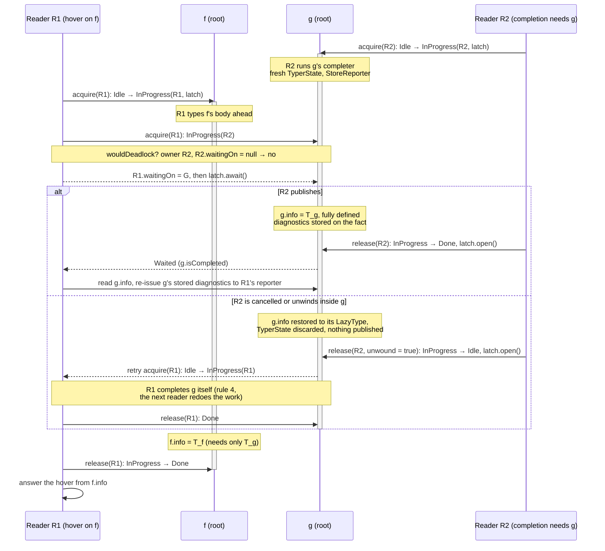

# Several readers over one session: design notes

Status: exploration, 23 October 2026. Builds on the session of [interactive-session.md](interactive-session.md) (targeting, one run per content, cancellation that unwinds) and on Track I's models in `retronym/jvm-lang-models` (`packages/scala/docs/track-i*.md`, `Query/Lazy.lean`, `Query/Interrupt.lean`, `ScalaTypes/ToyTree.lean`, the Java toy in `packages/scala/probes/interrupt`). No code yet.

## Summary for a busy reader

The session answers one request at a time: Metals' `CompilerAccess` queues requests on one thread, and the driver's run, typer state and caches assume a single caller. The question here is what it takes for two requests on the same session (a hover while the session is being completed in the background, two files' requests over one classpath symbol table) to run at the same time, the way Kotlin's K2 Analysis API and IntelliJ's PSI serve concurrent read actions.

The answer this note proposes:

- **A read/write regime, not snapshots.** A write (new content: a fresh run, a re-index) is exclusive; it raises the session's sticky cancellation flag, waits for the readers to unwind, and then mutates. Readers are `runUpTo` requests at the typer phase. Roslyn-style immutable snapshots, where an old reader finishes against the old world while the new one is built, are out of reach while a run brings shared classpath denotations forward to its own run id (I14): the symbol table's clock does not roll back, so two runs cannot be read at once.
- **What a reader may write, by K2's four rules.** A reader writes only what is (1) derived and disposable by the next write, (2) published once and only when consistent, (3) idempotent, so whichever reader wins writes the same value, and (4) left unpublished if the reader is cancelled. dotc's typer state sorts into five kinds against those rules (§3); each kind has one treatment.
- **Completion becomes K2's lazy resolve.** A denotation's completion gets an owner: the thread completing it sees its intermediate state (a `TempClassInfo`, a re-entrant `Touched`), every other thread waits on a barrier until the completer publishes or unwinds, and an unwound completion leaves the symbol completable for the next reader. This is `FirInProcessOfResolvingToPhaseStateWithBarrier` in LL FIR and the black hole two evaluators meet in a parallel Haskell runtime.
- **Concurrency adds three hazards that abort-and-restart did not have** (§4). A *peek* at an in-progress completion (`isCompleting`, thirteen sites) becomes a race whose outcome depends on timing, so a peek must mean "in progress on this thread" and otherwise wait. A *wait-for cycle* between two threads is a dependency cycle and must be reported as `CyclicReference` in the thread that closes it, not deadlock. And *side effects of forcing* land on whichever reader forced: a completer's diagnostics go to that reader's reporter, so a hover that forced a signature swallows the error a diagnostics pass needed; they have to be stored with the fact.
- **Skipped statements are facts too.** A resume into a skipped statement is a lazy computation over a shared value; it gets the same owner/barrier treatment, and the unit's typed tree becomes a persistent value replaced by compare-and-set rather than spliced in place.
- **The batch compiler pays nothing it can measure.** The concurrent implementations (interning, caches that are maps, the completion barrier) are chosen when the `ContextBase` is built in interactive mode; the shared fast paths change only where a field's publication must be ordered, and that is measured with perflab before it is kept.
- **Model first, as Track I did.** Two forcers over one `Query.Lazy` store with owned black holes: an interleaving that respects the barrier agrees with a sequential `forceAll`, a wait-for cycle implies a dependency cycle, and a peek at another thread's black hole is the counterexample. The Java toy gets a concurrent dotc kernel and a deterministic scheduler over its safepoints.

Whether to build it at all is §1's question, and step 0 of the plan measures it.

## 1. What a second reader buys

With targeting and sticky cancellation, one reader at a time already gives most of the keystroke latency: a completion made obsolete by the next keystroke unwinds within 1,024 typed trees, and the next one types only its path. What one reader cannot do:

- **Background work beside foreground requests.** IntelliJ's daemon highlights a file while completion and hover run; K2's highlighting pass and the completion contributor are concurrent read actions on the same FIR. The dotc analogue is completing the session (typing every skipped statement, which document highlight, semantic tokens and diagnostics want) while hovers are served from what is already typed. Today the whole-file `run` and the hover queue behind each other.
- **Several open files over one symbol table.** The session design's future work, a session per open file, wants the files' readers to share classpath symbols (loaded once, completed once) and not to serialise.
- **Range requests in parallel.** Semantic tokens and inlay hints over the visible lines are independent ranges of one file.

What it costs is the rest of this note. The measurement that decides it is the queueing delay in a Metals request trace (how long requests wait behind another request in `CompilerAccess`), next to I12's finding that most of a completion's time is spent outside the compiler. If queueing is small once targeting is in, the cheaper move is cancel-the-older-reader, which exists.

## 2. The regime: read actions and write actions

**Readers.** A reader is one request (`runUpTo` to a target, a resume, a range) at the typer phase of the session's run. Readers run at the same phase, so no denotation transformer runs during reading and the only movement of a denotation ring is a classpath denotation brought forward to the session's run id, which is a completion like any other (§3, kind B).

**Writers.** A writer is anything that changes the source of truth: new content for a file (a fresh run), re-parsing a poisoned statement and re-indexing it, `completeSymbolsOf` before a file is left, and the end of a run. A writer raises the sticky flag that `Run.checkCancelledTyping` polls, waits for every reader to unwind to the request boundary, and runs alone. This is IntelliJ's pending write action cancelling read actions at their next `checkCanceled`, and K2's modification events invalidating `KaSession`s. A cancelled reader is restarted by its caller (`ReadAction.nonBlocking`; in Metals, the next request).

The latency of a write is the time to the slowest reader's next checkpoint. The typer polls every 1,024 trees; implicit search does not poll (I11), so a long implicit search delays the writer, as it delays cancellation today.

**Not snapshots.** Roslyn's `Compilation` is immutable: an edit makes a new compilation that shares what the edit did not touch, and a reader on the old one is never disturbed. dotc cannot do that while runs share mutable denotations: a run brings the classpath denotations it touches forward to its run id, and a query under the previous run then finds them invalid (I14). Snapshot readers across an edit need facts that outlive a run (stage 3 of the cancellation design: completers as functions of node and owner, revisions re-validated by trace), and are future work here.

## 3. What a reader writes, by kind

The four rules, stated for dotc:

1. **Disposable.** Everything a reader writes is thrown away by the next writer, or re-validated by it. A run is already this: an edit discards it.
2. **Published once, consistent.** Another reader sees either "not computed" or the finished value, never a partial one.
3. **Idempotent.** Any reader computing it would write the same value, so a race to publish needs no lock, only safe publication.
4. **Cancellation leaves it unpublished.** A reader unwound midway leaves the fact as it found it; the next reader recomputes.

The typer's state sorts into five kinds:

| kind | dotc instances | rules it meets today | treatment |
|---|---|---|---|
| A. per-request scratch, wrongly shared | `ContextBase`: the context pools and `ContextPool.inUse`, the `comparers` stack, `findMemberCount`, `pendingUnderlying`, `recursiveDepth`, `errorsToBeReported`; one `Typer` per run (`Run.scala`, `setTyper(new Typer)`) with its `unimported`; the session's slots on `Run` (`typingTarget`, `skippedStats`, `targetedStatsOwner`, `targetingTyperState`, `completing`, `cancelledCompletions`, the checkpoint counter); the driver's single `mySession` and `myCancelled` | 1, but shared between concurrent readers | move to a thread-confined `Reader` (step 2) |
| B. lazy facts with a black hole | `completeFrom`'s `Touched` in `myFlags` (an unsynchronised read-modify-write); `InheritedCache.locked` for base data and member names (a second black hole); `Denotation.current`, which writes validity and the `nextInRun` ring on the first read in a run; symbol loaders and TASTy completers, which share a per-file `TreeUnpickler` (`symAtAddr`, `treeAtAddr`) and enter into shared `MutableScope`s that rehash on `enter`; lazy annotations | 1, 4 (since the session's unwinding); not 2 | owner + barrier per root (§3.1) |
| C. pure caches of derived values | `Symbol.lastDenot`/`checkedPeriod` (written in that order the wrong way round for a reader: the period first); `NamedType`'s `lastDenotation`/`lastSymbol`/`checkedPeriod`/`mySignature`; period- or run-stamped memos on `ClassDenotation` (`myMemberCache`, `myBaseTypeCache`, mutable maps filled on read) and on types (`myBaseClasses`, `myReduced`, …); `Definitions.PerRun`; `ImplicitRunInfo.implicitScopeCache`; `errorTypeMsg`; `ContextBase.sources`; 634 `@threadUnsafe lazy val`s | 1, 3; 2 only if one field and not a mutable map | one-field publication; multi-field caches packed into one immutable value; maps concurrent in interactive mode |
| D. interning and counters | `Uniques`, `NamedTypeUniques`, `AppliedUniques` (unsynchronised `WeakHashSet`s on the hottest path of type creation); `_nextSymId += 1`; `NamedType.setDenot` rewriting `designator`, part of the interned key. Names are already safe (`Names.enterIfNew` and `derivedNames` are `synchronized`) | 3 only if linearizable | a concurrent interner in interactive mode; atomic counters |
| E. trees | `SymOfTree`, `TypedAhead`, `ExpandedTree` removed when typed (I8); `nestedTyper.remove(sym).get`; `setMods` on the untyped original; `withTypeUnchecked` assigning `myTpe` in place; `span_=`; the session's splice into the unit's `tpdTree` | not 2, not 4 (I8) | skipped statements as facts; the typed tree as a persistent value (§3.2) |

dotc has no precedent for concurrent readers of symbols or types. Parallel pickling and `-Ybackend-parallelism` both keep every access to the symbol table on the main thread and hand workers only context-free work (`computePickled`, ASM post-processing). `ContextBase.checkSingleThreaded`, asserted at the start of a run, records the assumption.

### 3.1 Completion as lazy resolve

Today a denotation's completion is a two-state black hole with one owner implied: `Touched` is set in `lockAndComplete`, the completer runs, `Touched` is cleared on the way out, and a re-entry while it is set is a `CyclicReference`. The session added `Run.completing`, the set of completions in progress, so that a `Touched` left by an unwound completion can be told from a cycle (`healLeakedTouched`).

With several readers the state needs its owner:

- **Not completed.** The info is a `LazyType`.
- **In progress, owned by reader R.** R is completing it. R sees what the completer has set so far (a class's `TempClassInfo`, a module's partial info) and a re-entry from R is a cycle, as today. Any other reader that needs the info waits on the barrier.
- **Completed.** The info is published; nobody waits.

An unwind (cancellation, a cycle, an exception) restores "not completed", releases the barrier, and a waiter takes ownership and completes it itself. This is LL FIR's resolve state per declaration and phase, where `FirInProcessOfResolvingToPhaseStateWithBarrier` carries the latch that other threads wait on, and `Run.completing` becomes the owner field. It meets rule 2 because nobody but the owner sees the intermediate state, and rule 4 because an unwind restores the lazy type.

What a completer reads must not be per-reader. Today a Namer completer runs in its creation context (`creationContext`, the namer's `ictx`): its typer state, its reporter, the `nestedTyper` map of the completer, `knownTypeSig`. Two readers completing two symbols of one file both write the namer's typer state. Each completion gets a fresh committable typer state of its own, whose result is fully defined when it is published (completers already call `fullyDefinedType` on inferred types), and its own reporter (§4.3).

**Two readers racing on one inferred signature.** Reader R1 (a hover) needs `def f = g + 1`, whose result type is inferred, so its completer types `f`'s body and needs `g`'s type; reader R2 (a completion elsewhere) already needs `def g = ...`, also inferred. Neither types what the other is typing; R1 waits for `g`, then owns `f`.



What the diagram relies on, rule by rule: nobody but the owner sees `f` or `g` half-completed (rule 2, the barrier); whichever reader completes `g` writes the same `T_g`, since the completer is a function of the node and its owner's signatures and runs in its own typer state (rule 3); an unwound completion publishes nothing and leaves the root `Idle` (rule 4); and a wait is taken only after the wait-for check of §4.2, so if `g`'s completer in turn needed `f` (both inferred, each body referring to the other), R2 would find `R1.waitingOn = G` on its path and raise `CyclicReference` in R2 rather than block, which is the answer a sequential run gives for that pair.

Groups: a symbol loader completes a class and its module together, and the TASTy completers of one file share one `TreeUnpickler`'s address maps. The barrier is per *root* (the pair, or the file), not per symbol. A completion that enters into a scope another reader may be looking up in (a package's declarations) needs that scope to be safe to read during an `enter`, or the enter to happen under the scope owner's barrier.

`InheritedCache.locked` (base data, member names) is a second black hole with the same shape and gets the same treatment.

### 3.2 Trees

The session's tree state is mutable in three ways: the unit's `tpdTree` is spliced into on a resume, the skipped list is updated, and typing consumes the untyped tree's attachments (I8). A resume is the tree-level lazy fact: a skipped statement is "not typed", "being typed by R", or "typed, with this tree". It gets the same owner and barrier, and a reader that finds it in progress waits for it rather than typing it again. The typed tree of the unit becomes a persistent value: a reader takes the current one, a resume publishes a new one with its statement spliced in, by compare-and-set against the one it started from (two resumes into different statements both succeed, one after the other).

I8 matters more here than before. Today a statement unwound by a cancellation is re-parsed and re-indexed, which is a write; with several readers, a cancelled owner would hand its waiters a consumed tree. Either the re-parse is promoted to a write action (cancel every reader, re-index), or the consuming sites become non-destructive first, which is the first step of stage 3 anyway (fourteen sites, `getAttachment` for `removeAttachment`).

## 4. What concurrency adds

Abort-and-restart had one rule: every invariant holds at every checkpoint, so an unwind leaves nothing wrong. Concurrency keeps that rule and adds three.

### 4.1 A peek becomes a race

Thirteen sites ask `isCompleting` and choose a different path when a completion is in progress rather than forcing it: an import being completed is not used to resolve a name (`Typer.scala:384`, `:572`), a parent object being completed is skipped (`Typer.scala:3771`, `SymDenotations.scala:2692`), a class completer is not asked for its desugared tree (`Desugar.scala:123`). Track L calls this the peeking consumer (`forcePeek` in `Query/Lazy.lean`): its answer depends on the order of evaluation, and is deterministic only because the order is. With two readers, "in progress" can mean "on the other thread", and the answer then depends on timing.

The rule: `isCompleting` means "in progress on this reader". In progress on another reader, the peek waits for it like any other read, and then sees a completed symbol. A peek that waits can close a wait-for cycle, which is §4.2.

### 4.2 A wait-for cycle is a dependency cycle

Reader 1 completes A, whose signature needs B; reader 2 completes B, whose signature needs A. Each waits on the other's barrier. Single-threaded, the same pair is a `CyclicReference`, raised wherever the evaluation order closes the loop. So a wait that would close a cycle in the wait-for graph (each reader waits on at most one barrier; following owners from the barrier back to the waiting reader is the check, and it is cheap since waits are rare) raises `CyclicReference` in the reader that would close it, and that reader unwinds its completion as §3.1 says. The other reader's wait then succeeds.

Which reader gets the cycle depends on timing, as which symbol gets it depends on order today; Track L measured that dotc's cycles are already order sensitive, and the session's degradation (a cycle costs one symbol for one request, and nothing computed under it is cached) is what makes the answer recoverable on the next request. The guarantee to state is the session's: no answer differs from a fresh whole-file run except where a sequential evaluation in some order would also have reported the cycle.

Salsa detects cross-thread query cycles the same way (each blocked query records the runtime it waits on). IntelliJ avoids the problem by not sharing in-progress state at all: `RecursionManager` is per thread, two threads may compute the same value, and the cache takes whichever finishes (rule 3).

### 4.3 Side effects of forcing land on the forcer

Whoever forces a fact today gets its side effects:

- **Diagnostics.** A completer reports through its creation context's reporter, or through the reader's. With several readers, an error in a signature goes to whichever reader forced it first; if that was a hover, which discards its diagnostics, the diagnostics pass never sees it. The cure is the one stage 3 needs for reuse across runs: a child `StoreReporter` per completion, its diagnostics stored with the fact and re-issued to every reader that reads the fact (deduplicated by position).
- **Facts registered on other symbols.** A completer registers its symbol as a child of a sealed parent (`registerIfChildInCreationContext`), and desugaring merges a case class's synthetics into its companion's tree (I13, I22). These are writes to another symbol's state from inside a completion; under the owner rule they need the target's barrier, or (better, and what I13's fix already moved toward) to be computed by the target's own completer.
- **Fresh names and ids.** Symbol ids and a unit's fresh-name counters are allocated in evaluation order. Targeting already broke "in source order" (a resume into object 200 before object 5), so an oracle comparing with a whole-file run must already compare up to fresh names; concurrency makes the order nondeterministic as well. Counters become atomic; nothing should depend on their order.

## 5. The batch compiler pays nothing it can measure

Interning (kind D) and the caches that are maps (kind C, implicit scopes, error messages) get concurrent implementations chosen when an interactive `ContextBase` is built; the batch compiler keeps its own. The completion barrier lives on the interactive path that `lockAndComplete` already has (batch pays one mode test today). What cannot be chosen per mode are fields read on hot paths of the shared code, a `NamedType`'s cached denotation and the period it was checked in: these need one-field publication (pack the pair into one immutable value, or order the writes with release/acquire), and on Apple silicon release/acquire are `stlr`/`ldar`, not plain stores. Each such change is benchmarked with perflab (paired A/B, the compiler labs) before it is kept.

`@sharable` and `-Ycheck-reentrant` are the existing inventory of global mutable state; a checker for "written during typer by a reader, not of kinds B–E" is the tool that keeps the inventory current.

## 6. Prior art

- **Kotlin K2, the Analysis API's low-level FIR.** FIR declarations are resolved lazily to a phase, in place, under read access; a per-declaration lock with a barrier makes one thread advance a declaration while the others wait; a phase is published only once the declaration is consistent and does not advance on cancellation; "jumping" phases, whose resolution of one declaration can need another's, are where cross-thread cycles are handled. An edit inside a body with an explicit type invalidates that body alone (in-block modification). `KaSession` and its lifetime token make an analysis result unusable after the read action that produced it.
- **IntelliJ PSI.** Read and write actions under one lock, with a pending write cancelling readers at `checkCanceled`; everything but the parse a pure function of PSI cached under a modification count (`CachedValue`), computed by whoever asks first; `RecursionManager` per thread, with `mayCacheNow` refusing to cache a value computed under a prevented recursion. The Scala plugin computes types this way over immutable PSI.
- **Roslyn.** Immutable compilations; symbols complete in parts (`SymbolCompletionState`), any thread may complete a part, and the losers of a race wait for or discard their result; lazily computed fields published with compare-and-exchange; diagnostics added to the compilation's bag once, by the thread that completed the part. `concurrentBuild` binds method bodies in parallel over one symbol table, which is the shape of §1's background reader.
- **Salsa.** Parallel queries over one database, blocking on a query in progress on another thread, cross-thread cycle detection, cancellation by unwinding when the revision moves.
- **Parallel lazy evaluation.** Two evaluators meeting one thunk under evaluation: one blocks on the other's black hole (Harris, Marlow and Peyton Jones 2005), already Track I's reference for `Touched`.

## 7. Model first

Track I's method is to state the property over `Query.Lazy`, find the counterexamples in the Java toy, and then build. The statements:

- **Linearizability.** Two forcers over one store, black holes tagged with their owner, a forcer that meets another's black hole waiting: every interleaving agrees with a sequential `forceAll` of the two demand lists (the concurrent counterpart of `forceAll_ok`).
- **Cycles.** A wait-for cycle between forcers implies a cycle in the rules' dependency graph.
- **Peek.** A peek at another forcer's black hole gives two interleavings with different answers; a peek restricted to the forcer's own black holes gives none.
- **Abort.** An owner unwound while others wait: the waiter that takes over reaches the same store as if the owner had never started (the `abort_*` theorems of `Query/Interrupt.lean`, with a waiter).

The Java toy gets a `dotc-concurrent` kernel and a deterministic scheduler that interleaves two requests at every pair of safepoints, the way the Track I harness injects one request at every safepoint. On dotc itself, Lincheck (model checking of JVM concurrent code) for the completion state machine and the interner, and the soak and oracle suites run with two readers.

## 8. Plan

- [ ] **0. Measure.** Queueing delay in a Metals request trace on the compiler's own sources, with the session; the share of a reader's time inside completers versus body typing (JFR), which says whether a coarse completion lock (step 3) leaves enough concurrency.
- [ ] **1. Model.** §7's four statements in Lean; the concurrent kernel and scheduler in the Java toy.
- [ ] **2. A `Reader`.** Move kind A (per-request scratch) off `Run` and `ContextBase` into a thread-confined reader: the target, the skipped-statement bookkeeping, `completing`, the cancellation checker, the comparers and context pools. Still one reader at a time; batch unchanged.
- **The PoC harness is the x-ray, not Metals.** `XrayServer` drives `InteractiveDriver` directly, so it bypasses mtags-shared's single-thread `CompilerJobQueue` (the serialization point for every Metals request on a build target), and `Latch.await` holds a run at a known point while a second thread issues a hover. The case to show is the one step 0 found: a served hover beside a whole-file `run` or a session completion of the same file, and two resumes into different skipped statements.
- [ ] **3. Several readers, one completion lock.** The read/write regime in `InteractiveDriver`; kinds C and D made safe; every completion and every resume under one reentrant lock, so concurrency is in body typing only (K2 started from global locks too). Soak and oracle suites with two readers.
- [ ] **4. Completion as lazy resolve.** The owner and barrier per root (§3.1), wait-for cycle detection (§4.2), peeks restricted to the reader (§4.1), a typer state and a reporter per completion, diagnostics stored with the fact (§4.3).
- [ ] **5. Trees.** Skipped statements as facts with a barrier, the typed tree as a persistent value (§3.2), after non-destructive attachments (I8).
- Future work: snapshot readers across an edit, which needs facts that outlive a run (stage 3).

## 9. Open questions

- Does any completer read state that is per reader and not per run, besides the typer state and the reporter (the target, the cancellation checker, `NotNullInfo`s)?
- Is a fresh typer state per completion semantics-preserving? A completer's type-ahead today can leave constraints in the namer's typer state; whether anything relies on that is to check.
- What does a waiter do when the owner is cancelled by a *writer*? It is cancelled too; the barrier only needs to release, not hand over. Hand-over is for owners unwound by their own failure.
- The checkpoint gap in implicit search (I11) bounds write latency; is a checkpoint there a prerequisite?

## 10. Ten diffs, sketched

Plausible shapes for the changes the plan asks for, one per blocker, each small enough to read and annotated with the rule it serves. They are sketches against `track-i/dotc-session`, not patches: names and placement will move when built, and every one that touches a shared hot path is kept only after a perflab A/B (§5).

### 10.1 `ContextBase`: a reader per thread (kind A, step 2)

```diff
 class ContextBase extends ContextState with Phases.PhasesBase with Plugins {
-  private[dotc] val comparers = new ArrayBuffer[TypeComparer]
-  private[dotc] var comparersInUse: Int = 0
-  private[dotc] val exploreContextPool = ExploreContextPool()
-  private[dotc] val freshTSContextPool = FreshTSContextPool()
-  private[dotc] val generalContextPool = ContextPool()
-  private[core] var findMemberCount: Int = 0
-  private[core] var pendingUnderlying: util.HashSet[Type] = new util.HashSet[Type]
+  /** Scratch that belongs to the thread evaluating, not to the symbol
+   *  table: the comparer stack, the context pools, the recursion counters.
+   *  Batch mode has one thread and one Reader, reached through a plain
+   *  field; interactive mode has one per reader thread.
+   */
+  private val batchReader = new Reader
+  private val readers: ThreadLocal[Reader] = ThreadLocal.withInitial(() => new Reader)
+  private[dotc] def reader: Reader =
+    if isInteractive then readers.get() else batchReader
```

`Reader` holds exactly the fields the §3 table lists under A, with the session's targeting slots and `completing` moved there from `Run`. The batch path pays one branch; the field accesses that used to be `base.comparers` become `base.reader.comparers`, which is the same load count after inlining.

### 10.2 `Run`: targeting slots move to the reader (kind A, step 2)

```diff
 class Run(comp: Compiler, ictx: Context) {
-  var typingTarget: Span = Spans.NoSpan
-  var skippedStats: List[SkippedStat] = Nil
-  var targetedStatsOwner: Symbol = NoSymbol
-  var targetingTyperState: TyperState | Null = null
-  val completing: mutable.HashSet[Symbol] = mutable.HashSet.empty
-  private var typedTreeCount = 0
-  def checkCancelledTyping()(using Context): Unit = ...
+  // The session's per-request state lives on `ctx.base.reader` (Reader.scala):
+  // the target, the skipped statements, the statements-list marks, the set of
+  // completions in progress, the checkpoint counter. Two requests on one run
+  // never share a slot.
```

`Targeting.scala`'s "is this the request's own statement list" test, `ctx.typerState eq run.targetingTyperState`, becomes `ctx.typerState eq reader.targetingTyperState`, which is what it meant.

### 10.3 `InteractiveDriver`: read and write actions (step 3)

```diff
 class InteractiveDriver(val settings: List[String]) extends Driver {
+  /** Readers run `runUpTo` and resumes concurrently; a writer (new content,
+   *  a re-index, `completeSymbolsOf`, the end of a run) raises the sticky
+   *  cancellation, waits for every reader to unwind, and runs alone.
+   *  IntelliJ's pending write action, with `checkCancelledTyping` as the
+   *  reader's `checkCanceled`.
+   */
+  private val regime = new ReadWriteRegime(cancelReaders = () => myCancelled = true)
+
   def runUpTo(uri: URI, source: SourceFile, target: Span): List[Diagnostic] =
-    runUpTo0(uri, source, target)
+    regime.read { runUpTo0(uri, source, target) }
+
+  private def freshSession(uri: URI, source: SourceFile): Session =
+    regime.write { startTargetedRun(uri, source) }
```

`ReadWriteRegime` is a `StampedLock`-shaped object with one addition: `write` sets the cancel flag before taking the lock, so readers reach their next checkpoint and release instead of finishing. A reader cancelled by a writer answers its default, as it does today for a cancel from Metals.

### 10.4 `Session`: the typed tree as a persistent value (kind E, step 5)

```diff
 private class Session(val uri: URI, val source: SourceFile, val run: Run, ...) {
-  var skipped: List[SkippedStat]
-  def splice(stat: SkippedStat, typed: tpd.Tree): Unit =
-    unit.tpdTree = Splicer(stat, typed).transform(unit.tpdTree)
-    skipped = skipped.filterNot(_ eq stat)
+  /** One immutable value: the typed tree and the statements still skipped.
+   *  A resume publishes a new one by compare-and-set against the one it
+   *  read, so two resumes into different statements both land, in turn,
+   *  and a reader that lost the race re-reads and splices again (cheap:
+   *  the splice copies only the path to the owner).
+   */
+  final case class State(tpdTree: tpd.Tree, skipped: List[SkippedStat])
+  val state = new AtomicReference(State(unit.tpdTree, initialSkipped))
+  def splice(stat: SkippedStat, typed: tpd.Tree): Unit =
+    state.updateAndGet(s => State(Splicer(stat, typed).transform(s.tpdTree), s.skipped.filterNot(_ eq stat)))
```

`SkippedStat` itself gains an owner slot (`AtomicReference[Reader | Null]`) and a latch, the same shape as 10.6, so a reader that finds a resume in progress waits for its tree rather than typing the statement again.

### 10.5 `Uniques`: interning chosen per mode (kind D, step 3)

```diff
 class ContextBase ... {
-  private[core] val uniques: Uniques = Uniques()
-  private[dotc] val uniqueAppliedTypes: AppliedUniques = AppliedUniques()
-  private[core] val uniqueNamedTypes: NamedTypeUniques = NamedTypeUniques()
+  // Batch keeps the open-hashing WeakHashSets; interactive mode uses
+  // striped tables (a lock per bucket range) so that two readers creating
+  // the same type get one object, which `eq`-based reasoning needs.
+  private[core] val uniques: Uniques = if isInteractive then Uniques.concurrent() else Uniques()
+  private[dotc] val uniqueAppliedTypes: AppliedUniques = if isInteractive then AppliedUniques.concurrent() else AppliedUniques()
+  private[core] val uniqueNamedTypes: NamedTypeUniques = if isInteractive then NamedTypeUniques.concurrent() else NamedTypeUniques()

-  def nextSymId: Int = { _nextSymId += 1; _nextSymId }
+  private val _nextSymId = new AtomicInteger(0)
+  def nextSymId: Int = _nextSymId.incrementAndGet()
```

The `Names` table needs nothing: `enterIfNew` and `derivedNames` are already `synchronized`. The sym id counter is on the batch path too; an uncontended `incrementAndGet` is one `lock xadd`, and the A/B decides whether batch keeps the plain field behind the same `isInteractive` test.

### 10.6 `SymDenotations.lockAndComplete`: an owner and a barrier (kind B, step 4)

```diff
   private inline def lockAndComplete(completer: LazyType)(using Context): Unit =
-    val interactive = ctx.mode.is(Mode.Interactive)
-    val run: Run | Null = if interactive then ctx.run else null
-    if myFlags.is(Touched) && !healLeakedTouched(run) then
-      if run != null then run.recordCyclePrevented(symbol)
-      throw CyclicReference(this)(using ctx.withOwner(symbol))
-    myFlags |= Touched
-    if run != null then run.completing += symbol
-    try atPhase(validFor.firstPhaseId)(completer.complete(this))
-    catch case ex => onUnwind(ex, interactive, run); throw ex
-    finally if run != null then run.completing -= symbol
+    if !ctx.mode.is(Mode.Interactive) then
+      // Batch: the one-bit black hole, as before.
+      if myFlags.is(Touched) then throw CyclicReference(this)(using ctx.withOwner(symbol))
+      myFlags |= Touched
+      atPhase(validFor.firstPhaseId)(completer.complete(this))
+    else
+      // Interactive: the root's completion state is Idle | InProgress(owner, latch) | Done.
+      // The owner sees its intermediate state (TempClassInfo, a re-entrant Touched
+      // is a cycle, as before); any other reader waits on the latch (10.7 decides
+      // whether the wait would close a cycle). An unwind restores Idle and opens
+      // the latch, so a waiter takes ownership and completes it itself.
+      val reader = ctx.base.reader
+      completionRoot.acquire(reader) match
+        case Acquired =>
+          try atPhase(validFor.firstPhaseId)(completer.complete(this))
+          catch case ex => completionRoot.release(reader, unwound = true); onUnwind(ex, reader); throw ex
+          completionRoot.release(reader, unwound = false)
+        case Reentrant =>
+          reader.recordCyclePrevented(symbol)
+          throw CyclicReference(this)(using ctx.withOwner(symbol))
+        case Waited =>
+          () // completed by another reader; `isCompleted` is now true
```

`completionRoot` is the class for a module class and its module, and the file for TASTy-loaded symbols (10.9), so that the loaders' "complete the pair together" stays one critical section. `Touched` in `myFlags` stays as the batch bit; the interactive state lives beside the denotation, allocated on first contention only.

### 10.7 `CompletionRoot.acquire`: a wait that would close a cycle is a cycle (step 4)

```diff
+  /** Wait-for check before blocking: follow owners from this root's barrier.
+   *  Each reader waits on at most one root at a time (`reader.waitingOn`), so
+   *  the chain is a path; if it reaches `me`, blocking would deadlock, and
+   *  sequentially the same pair is a CyclicReference, raised wherever the
+   *  evaluation order closes it. Raise it here, in the reader that would
+   *  close it; the other reader's wait then succeeds.
+   */
+  private def wouldDeadlock(me: Reader): Boolean =
+    var r: Reader | Null = owner
+    while r != null do
+      if r eq me then return true
+      r = r.waitingOn match { case null => null; case root => root.owner }
+    false
+
+  def acquire(me: Reader): Acquired.type | Reentrant.type | Waited.type =
+    val o = owner
+    if o eq me then Reentrant
+    else if o == null && ownerRef.compareAndSet(null, me) then Acquired
+    else if wouldDeadlock(me) then throw CyclicReference(denot)(using me.ctx)
+    else { me.waitingOn = this; try latch.await() finally me.waitingOn = null; if isDone then Waited else acquire(me) }
```

The check reads other readers' `waitingOn` fields without a lock; a stale read can miss a cycle that formed in the meantime, so `await` is bounded (`await(timeout)`) and re-checks, which is Salsa's shape (each blocked query records what it waits on, and the cycle is found by the last one to block).

### 10.8 `isCompleting` means "on this reader" (§4.1, step 4)

```diff
-    final def isCompleting: Boolean = myFlags.is(Touched) && !isCompleted
+    /** A completion of this symbol is in progress on the calling reader. In
+     *  progress on another reader is not a peekable state: the thirteen sites
+     *  that choose a path by this test would otherwise choose by timing. They
+     *  wait instead (`ensureCompletedOrWait`) and then see a completed symbol.
+     */
+    final def isCompleting(using Context): Boolean =
+      !isCompleted && (if ctx.mode.is(Mode.Interactive) then completionRoot.owner eq ctx.base.reader else myFlags.is(Touched))
```

and at each site, for example `Typer.findRef`'s import check:

```diff
-            if imp.importSym.isCompleting then
+            if imp.importSym.isCompletingElsewhere then imp.importSym.ensureCompleted() // waits; 10.7 handles a cycle
+            if imp.importSym.isCompleting then
               report.warning(i"cyclic ${imp.importSym}, ignored", pos)
```

`Desugar.scala:123`'s `ClassCompleter if !sym.isCompleting` and `TypeApplications.scala:494` get the same two-line treatment.

### 10.9 `SymbolLoaders` and the TASTy `Completer`: the root is the file (kind B, step 4)

```diff
 class TreeUnpickler(...) {
+  /** One unpickler serves every lazy completer of its file and keeps per-file
+   *  address maps (`symAtAddr`, `treeAtAddr`). Those are the file's state, so
+   *  the file is the completion root: the first reader to force any symbol of
+   *  it owns the unpickler until that completion publishes.
+   */
+  val root: CompletionRoot = CompletionRoot.forFile(this)
   class Completer(reader: TastyReader)(using @constructorOnly _ctx: Context) extends LazyType {
     def complete(denot: SymDenotation)(using Context): Unit =
-      treeAtAddr(currentAddr) = ...
+      root.owned(ctx.base.reader) { treeAtAddr(currentAddr) = ... }
```

A `MutableScope` that a loader `enter`s into while another reader does `lookupEntry` rehashes under the reader: the scope gets a `@volatile` table reference published after the rehash is complete, and `lookupEntry` reads the reference once, so a lookup during a rehash sees the old table whole (a miss for the entry being entered, which is the sequential answer before the enter).

### 10.10 `Symbol.computeDenot`: publication order (kind C, step 3)

```diff
   private def computeDenot(lastd: SymDenotation)(using Context): SymDenotation = {
     val now = ctx.period
-    checkedPeriod = now
-    if lastd.validFor.contains(now) then lastd else recomputeDenot(lastd)
+    // Another reader must never see `checkedPeriod == now` with a `lastDenot`
+    // that is not valid in `now`: write the denotation first, the period last,
+    // and in interactive mode with release/acquire (a plain store on batch).
+    val d = if lastd.validFor.contains(now) then lastd else recomputeDenot(lastd)
+    publishChecked(now)   // VarHandle.setRelease in interactive mode, plain store otherwise
+    d
   }
```

The same reorder applies to `NamedType`'s triple (`lastDenotation`, `lastSymbol`, then `checkedPeriod`), where the invariants in the source already say which field implies which; packing the three into one immutable `CachedDenot(denot, sym, period)` and publishing the reference is the alternative when the A/B shows the ordered stores cost on the batch path.

What the ten leave out, deliberately: diagnostics stored with the fact (§4.3), which is the stage 3 reporter change and larger than a sketch; a fresh typer state per completion, which is §9's open question; and non-destructive attachments (I8), which stage 3 lists first and 10.4 depends on.
