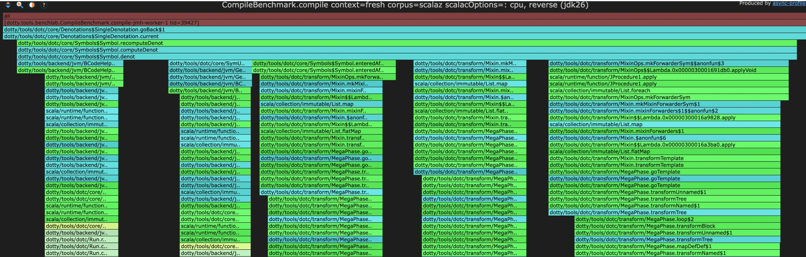

# `SingleDenotation.current` / `goBack` hotspot

Investigation notes (living doc). Not intended for upstream as-is.

## Observation

`CompileBenchmark.compile context=fresh corpus=scalaz`, async-profiler cpu, JDK 26, reverse flame graph: `SingleDenotation.goBack$1` is ~2.25% CPU, almost all **self** time.



Callers (bottom-up, approx share of the 2.25%):

- `MixinOps.mkForwarderSym` (the `tap` lambda: `addAnnotations`, `paramSymss`, `atPhaseBeforeTransforms`) — largest
- `Symbol.enteredAfter` ← `MixinOps.mkForwarderSym`
- `Mixin.mkMixinForwarderSym` / `Mixin.mixinForwarders`
- backend `BCodeHelpers` / `BTypesFromSymbols` / `SymUtils`

## Background: denotation time-travel

- `Period` = `(runId, firstPhaseId, lastPhaseId)` packed in an `Int`.
- A symbol's denotation versions within a run form a *flock*: a ring linked by `nextInRun`, sorted by phase, non-overlapping, contiguous; the last wraps to `initial`. No `prev` pointer.
- `Symbol` caches a single `(lastDenot, checkedPeriod)`. Any change of `ctx.period` misses → `computeDenot` → `recomputeDenot` → `lastDenot.current`, which overwrites `lastDenot`. Alternating phases thrash this one-slot cache.
- `current`: different run → `toNewRun`; `period > valid` → `goForward` (walk forward, lazily run the next `DenotTransformer`, `insertAfter`); else → `goBack` (walk `nextInRun` *forwards*, wrapping round the ring, until a version contains the period).
- New symbols get `currentStablePeriod` (from just after the previous denot transformer to the next one). `installAfter` / `enteredAfter` / `ensureFreshScopeAfter` splice new versions at `phase.next`.

## Why Mixin hits this

- `MegaPhase.run` transforms the whole group at `atPhase(miniPhases.last.next)`. For the Mixin group that is after `CapturedVars`; `LazyVals`, `Memoize`, `CapturedVars` are all denot transformers.
- Mixin code hops between: ambient (post-CapturedVars), `thisPhase`, `thisPhase.next` (`enteredAfter`, `ensureFreshScopeAfter`), `erasurePhase`, `atPhaseBeforeTransforms`. Each backward hop = cache miss + `goBack`.

## Hypothesis H1: degenerate spin in `goBack`

A symbol created at the ambient phase has a one-element ring whose `validFor` starts after `CapturedVars`. Querying it at an earlier phase (e.g. `dst.addAnnotations` on fresh forwarder params inside `atPhaseBeforeTransforms`; possibly `enteredAfter` at `Mixin.next`; backend `atPhase(erasure/typer)` on late symbols) can never match. `goBack` then loops `MaxPossiblePhaseId` (= `PhaseMask`, 255) times round the one-element ring before bailing out to `atPhase(coveredInterval.firstPhaseId)(current)`. That fits "all self time, L1-hot loop".

Status: **confirmed.** On scalaz: 3.98M `goBack` calls, of which 308,719 (7.7%) are bail-outs. At 256 steps each, they account for 79.0M of the 81.9M loop steps (96.5%). Top callers: `MixinOps.mkForwarderSym` (param annotations in `atPhaseBeforeTransforms`, `enteredAfter`), `Mixin.mkMixinForwarderSym` (`atPhase(erasurePhase)`), backend `BCSignatureGen.computeMemberType`, `GenericSignatures`, Memoize, Constructors.

## Fix

`goBack` keeps track of the earliest version seen and returns it when the walk gets back to `this`, after one lap. That is the same result as the old fallback `atPhase(coveredInterval.firstPhaseId)(current)` (asserted `eq` on all 308,719 bail-outs with `-Ddotty.goBackCheck=true`).

- Loop steps on scalaz: 81.9M → 3.2M.
- async-profiler (bench-lab, JDK 26): `goBack` self 2.26% → 0.25%; `recomputeDenot` incl 5.00% → 2.71%.
- Wall-clock JMH and xctrace counter A/B were inconclusive: the machine was loaded (load average 8–12, instructions per op ±38% between runs). Re-run on a quiet machine.

## Diagram: data structure and algorithm, before and after

Phase ids below are illustrative: `M` = Mixin, `C` = CapturedVars, `E` = Erasure, `T` = the phase `atPhaseBeforeTransforms` uses, `N` = the next denot transformer after `C`.

### The flock: one ring per symbol per run

```
Symbol                                      (one-slot cache)
 ├─ lastDenot ──────────────────┐            checkedPeriod == ctx.period ? lastDenot : recompute
 └─ checkedPeriod               │
                                ▼
   ┌──────────────┐   nextInRun   ┌──────────────┐   nextInRun   ┌──────────────┐
   │ D1           │ ────────────▶ │ D2           │ ────────────▶ │ D3           │
   │ validFor     │               │ validFor     │               │ validFor     │
   │ [1 .. E-1]   │               │ [E .. M]     │               │ [M+1 .. 99]  │
   └──────────────┘               └──────────────┘               └──────────────┘
          ▲                                                              │
          └───────────────────────── nextInRun (wraps) ──────────────────┘

 invariants: periods disjoint, union contiguous, ring ordered by phase; no `prev` pointer
```

`current` at phase `p`, starting from `this` (normally `lastDenot`):

```
  p inside this.validFor   → this
  p after  this.validFor   → goForward: follow nextInRun while periods increase;
                             if none covers p, run the next DenotTransformer and insertAfter
  p before this.validFor   → goBack: follow nextInRun (wrapping) until validFor contains p

  e.g. lastDenot = D3, p = E+2:   D3 ──▶ D1 ✗ ──▶ D2 ✓        (2 steps)
```

### The degenerate case: symbol looked up before it exists

`MegaPhase` runs the Mixin group at `C+1`. A forwarder's param symbol is created there, so its ring has a single node whose period starts after the last denot transformer before `C+1`. `MixinOps.mkForwarderSym` then annotates it inside `atPhaseBeforeTransforms`, i.e. at phase `T`, far earlier:

```
   ┌──────────────┐
   │ F            │ ◀──┐
   │ [C+1 .. N]   │    │ nextInRun = itself
   └──────────────┘ ───┘

   query at phase T  (T < C+1: no node can ever contain it)
```

**Before:** spin until the defensive counter trips, then go through `current` again at another phase.

```
  cur = F
  F ✗ → F ✗ → F ✗ → F ✗ → … → F ✗          cnt = 1 .. 256  (MaxPossiblePhaseId)
                                  │
                                  ▼
  coveredInterval      (another lap: F → F)              → [C+1 .. N]
  atPhase(C+1)(current)  (switch context phase, re-enter current → goBack, 0 steps) → F
```

**After:** stop when the walk is back at its start, and return the earliest node seen.

```
  cur = F, earliest = F
  F ✗ → F  (cur eq this: one full lap) → return earliest = F                1 step
```

The same applies to multi-node rings:

```
  ring  X [60..62] ──▶ Y [63..99] ──▶ (X),   this = Y,   query at phase 10

  before:  Y ✗ → X ✗ → Y ✗ → X ✗ → … (256 steps) → atPhase(60)(current) → Y → X  ⇒ X
  after:   Y ✗ → X ✗ (earliest = X) → Y (eq this) → return X                       ⇒ X   (2 steps)
```

The result is the same node the old fallback returned. This was checked with an `eq` assertion on all 308,719 such lookups while compiling scalaz. Per op, that removes about 79M of the 82M `goBack` loop steps (−96%), and `goBack` self time drops from 2.56% to 0.15% of samples.

## Side question: why no `prev` pointer?

The only rationale is the comment in `goBack` from a8b05409c9 (2016, JDK 8): best-of-10 wall-clock compiling dotc, 18154ms with `prev` vs 17777ms without (~2%). No size or upkeep argument given.

JOL (scala3-compiler 3.7.3, JDK 21), instance sizes:

| class | compressed oops | trailing gap | +`prev` (est.) | uncompressed |
|---|---|---|---|---|
| `SymDenotation` | 80 | 4B @76 | 80 (free) | 120 |
| `ClassDenotation` | 120 | none | 128 | 200 |
| `PackageClassDenotation` | 128 | none | 128–136 | 216 |
| `UniqueRefDenotation` / `JointRefDenotation` | 56 | 4B @52 | 56 (free) | 80 |

Upkeep: `nextInRun` is mutated only in `insertAfter` and `replaceWith`; the latter currently walks the ring to find the predecessor, which `prev` would make O(1).

`prev` would make `goBack` from the newest to the previous version 1 hop instead of a full lap, but does not fix H1.

## TODO

- [x] Instrument `goBack`: iteration histogram, bail-out count, by caller
- [x] Confirm / refute H1 on scalaz corpus
- [x] Fix: early exit on lap completion in `goBack`
- [ ] Wall-clock A/B on a quiet machine
- [ ] Clean upstream commit (drop TEMP commits)
- [ ] Reduce phase hopping in `MixinOps.mkForwarderSym`
- [ ] Re-measure `prev` pointer with JMH (future work)
